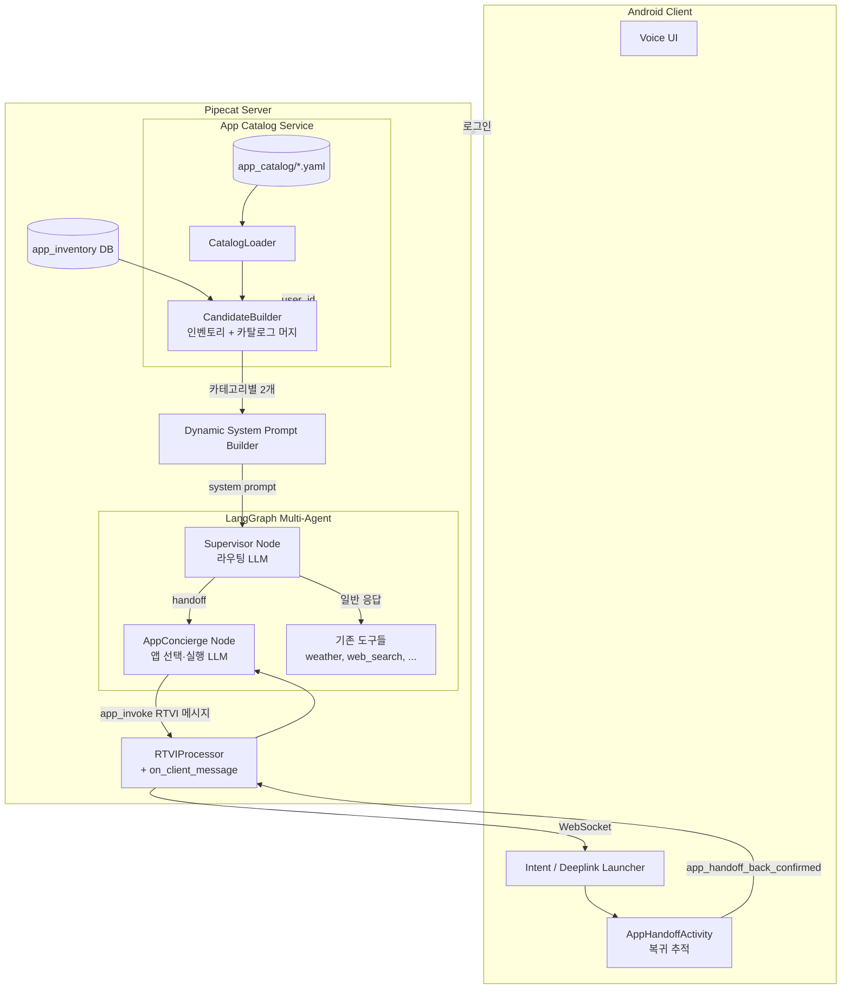
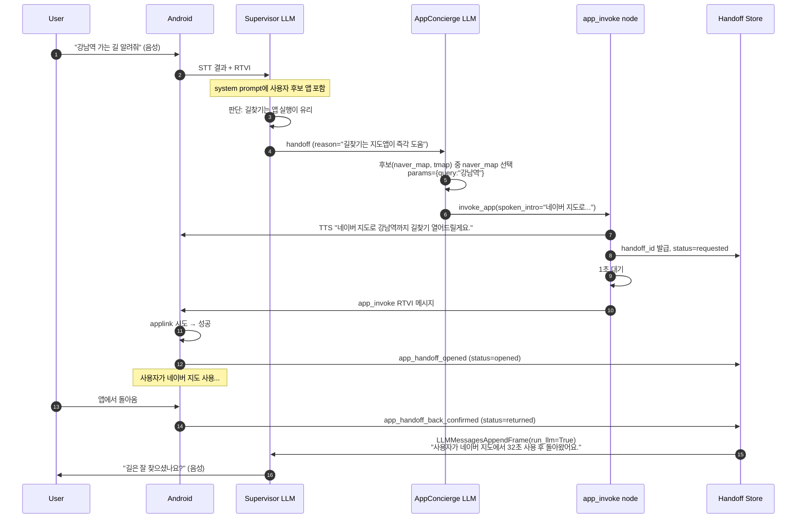
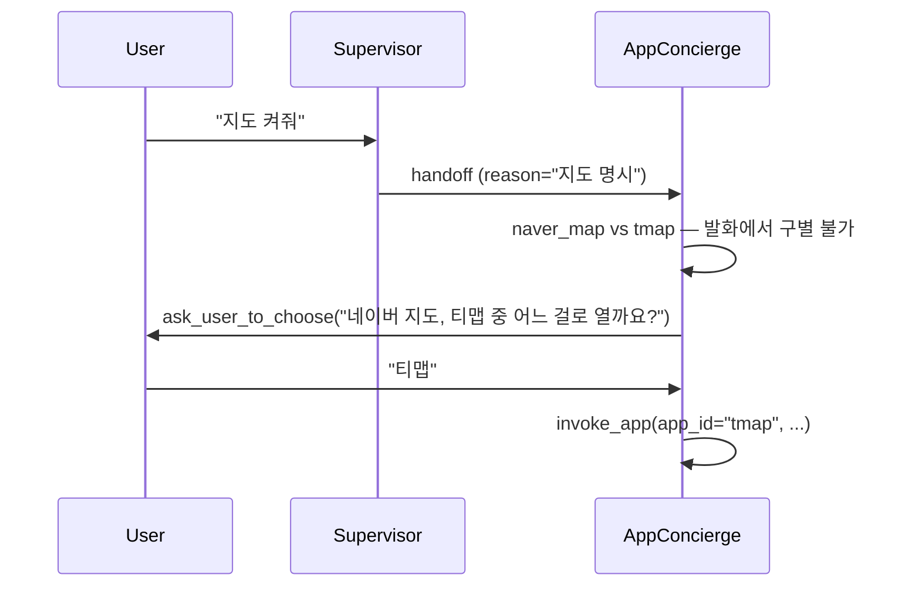
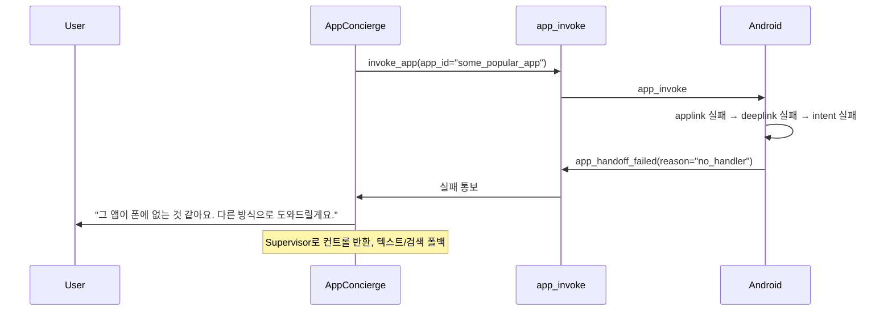

# AppConcierge Agent 설계 문서

> 사용자의 음성 발화를 분석해 **사용자 폰에 설치된 네이티브 앱을 직접 실행**해주는 멀티-에이전트 기능에 대한 설계.
>
> **문서 버전**: 0.1 (2026-04-27 초안)
> **선행 문서**:
> - `app-inventory-implementation.md` — 앱 인벤토리 수집/저장
> - `native-app-tools-llm-integration-design.md` — 네이티브 툴 호출 원칙·플로우
> - `external-handoff-llm-action-analysis.md` — 외부 진입/복귀(handoff) 메커니즘
> - `pipecat-langgraph-langchain-hitl-integration.md` — LangGraph 통합

---

## 1. 목표와 비-목표

### 1.1 목표

1. 사용자가 "강남역까지 길찾기 해줘", "엄마한테 카톡 보내줘" 같이 **앱으로 처리하는 게 더 빠른 발화**를 했을 때, 검색·요약 답변 대신 **앱을 직접 실행**한다.
2. 어떤 발화에서 앱 실행이 유리한지 판단하는 책임은 **Supervisor Agent**가 갖고, 실제 앱 선택·파라미터 추출·실행은 **AppConcierge Agent**가 갖는다 (역할 분리).
3. Supervisor가 적절한 시점에 AppConcierge로 **handoff** 할 수 있도록 **사용자별로 자주 쓰는 앱 리스트**를 로그인 시 동적 system prompt에 주입한다.
4. 앱 실행 전 **음성으로 한 번 안내** ("OO 앱 열어드릴게요") 후 실행하여 사용자가 취소할 여유를 준다.
5. 앱 실행 후 사용자가 다시 돌아오면 **결과를 LLM 컨텍스트에 자연스럽게 이어 붙인다** (handoff 메커니즘 재활용).

### 1.2 비-목표 (이번 단계에서 다루지 않음)

- 앱 내부의 deep automation (예: 카카오톡 안에서 메시지 자동 전송 + 답장 읽기) — deeplink로 화면만 띄우는 수준.
- 새로운 위험도 등급 시스템 — 일단 **모든 앱은 음성 안내 후 실행**하는 단일 정책으로 시작.
- 앱 사용 이력 학습/추천 — 인벤토리 통계는 카테고리 후보 산출에만 사용.

---

## 2. 의사결정 요약 (이 설계의 전제)

| # | 결정 사항 | 선택 |
|---|---------|------|
| 1 | Supervisor / AppConcierge 구조 | **(C) 하이브리드** — Supervisor LLM은 라우팅 결정만, AppConcierge는 같은 LangGraph 안의 별도 노드 (conditional edge로 분기) |
| 2 | 앱 카탈로그 저장 위치 | **(A) 정적 YAML/JSON 파일** (`mobile/app_catalog/*.yaml`) — git 관리 |
| 3 | 카테고리별 후보 2개 산출 방식 | **(C) 사용자 인벤토리 우선 2개, 부족분은 일반 인기 앱으로** |
| 4 | 미설치 앱 처리 | **(A) Supervisor 후보에서 제외** |
| 5 | 앱 실행 후 복귀 메커니즘 | **(A) 기존 handoff 메커니즘 재활용** (`app_handoff_*` 이벤트 추가) |
| 6 | 동일 카테고리 후보 2개 중 선택 | **(D)** LLM 선택 → 모호하면 사용자에게 음성 재질의 |
| 7 | system prompt 업데이트 시점 | **(A) 로그인 시 1회** |
| 8 | 사용자 확인 정책 | "OO 앱 열어드릴게요" 음성 안내 + **1초 대기 후 실행** (모든 앱 동일) |
| 9 | iOS 지원 준비 | 카탈로그 스키마에 `android_*` / `ios_*` 필드 분리 (실행은 우선 Android만) |
| 10 | AppConcierge 책임 범위 | **선택 + 파라미터 추출 + URL 조립 + 실행 푸시 + 안내 발화 + 복귀 처리 + 폴백** 모두 |

---

## 3. 시스템 아키텍처

### 3.1 컴포넌트 다이어그램



### 3.2 LangGraph 그래프 구조

```
                 ┌────────────┐
   StartFrame ──▶│  router    │ (entry — 사용자 발화 분류만)
                 └─────┬──────┘
                       │
            ┌──────────┼──────────────┐
            ▼          ▼              ▼
      ┌──────────┐ ┌──────────┐ ┌──────────┐
      │supervisor│ │app_concierge│ │ end       │
      │ (일반)    │ │           │ │           │
      └────┬─────┘ └─────┬─────┘ └──────────┘
           │             │
           ▼             ▼
      ┌──────────┐ ┌──────────────┐
      │  tools   │ │ app_invoke    │
      │ (ReAct)  │ │ (deeplink push)│
      └──────────┘ └──────────────┘
```

**노드 책임**:

| 노드 | 책임 | 모델 호출 |
|------|------|---------|
| `router` | 발화 분류 결과를 supervisor 컨텍스트에 추가 | 없음 (passthrough) |
| `supervisor` | 일반 도구 사용 + handoff 결정. 시스템 프롬프트에 사용자 인기 앱 리스트 포함 | LLM 1회 |
| `app_concierge` | 앱 선택, 파라미터 추출, 음성 안내, deeplink 조립 | LLM 1회 |
| `tools` | 기존 ReAct 도구 호출 | - |
| `app_invoke` | RTVI 메시지로 deeplink 푸시 + 1초 대기 + handoff 추적 시작 | 없음 |

**Conditional edge — supervisor 출력 분기**:
- supervisor가 `handoff_to: "app_concierge"` 도구를 호출 → `app_concierge` 노드로
- 그 외 → 기존 `tools` 노드 또는 `END`로

---

## 4. 데이터 모델

### 4.1 앱 카탈로그 (정적 YAML)

`mobile/app_catalog/` 디렉터리 아래 카테고리별 파일.

```
mobile/app_catalog/
  ├── navigation.yaml
  ├── social_chat.yaml
  ├── finance.yaml
  ├── shopping.yaml
  ├── music.yaml
  └── ...
```

**예시 — `navigation.yaml`**:

```yaml
category: navigation
display_name: "지도/길찾기"
apps:
  - app_id: naver_map
    display_name: "네이버 지도"
    package_name: com.nhn.android.nmap
    bundle_id: com.nhn.NaverMap
    popularity_rank: 1   # 일반 사용자 인기 순위 (3.3절 참조)
    use_when: |
      길찾기, 대중교통 경로, 주변 장소 검색, 특정 장소 위치 확인이 필요할 때.
      지도가 필요한 모든 종류의 발화에 적합.
    examples:
      - "강남역 가는 길 알려줘"
      - "여기 근처 카페 어디 있어?"
      - "서울역까지 지하철로 얼마나 걸려?"
    parameters:
      - name: query
        type: string
        required: true
        description: "검색어 또는 목적지 명칭"
      - name: lat
        type: number
        required: false
        description: "출발지 위도 (없으면 현재 위치)"
      - name: lng
        type: number
        required: false
    execution:
      android:
        - type: applink
          priority: 1
          template: "https://map.naver.com/v5/search/{query}"
        - type: deeplink
          priority: 2
          template: "nmap://search?query={query}&appname=com.example.voice"
        - type: intent
          priority: 3
          action: android.intent.action.VIEW
          uri_template: "geo:0,0?q={query}"
      ios:
        - type: universal_link
          priority: 1
          template: "https://map.naver.com/v5/search/{query}"
        - type: scheme
          priority: 2
          template: "nmap://search?query={query}"
    fallback:
      type: none   # A안: 미설치면 후보에서 제외하므로 fallback 불필요. 향후 확장 자리.

  - app_id: tmap
    display_name: "티맵"
    package_name: com.skt.tmap.ku
    popularity_rank: 2
    use_when: |
      자동차 길찾기, 운전 중 내비게이션이 필요할 때 특히 적합.
    examples:
      - "차로 부산까지 가는 길"
      - "내비 켜줘"
    parameters:
      - name: destination
        type: string
        required: true
    execution:
      android:
        - type: deeplink
          priority: 1
          template: "tmap://route?goalname={destination}"
```

**스키마 정의** (`mobile/app_catalog/schema.py`):

```python
from typing import Literal
from pydantic import BaseModel, Field

class CatalogParam(BaseModel):
    name: str
    type: Literal["string", "number", "boolean"]
    required: bool = False
    description: str | None = None

class ExecutionPath(BaseModel):
    type: Literal["applink", "deeplink", "intent", "universal_link", "scheme"]
    priority: int
    template: str | None = None      # 단순 URI 치환용
    action: str | None = None        # Android Intent action
    uri_template: str | None = None  # Intent용 URI

class CatalogApp(BaseModel):
    app_id: str  # 카탈로그 내 고유. tool name으로도 쓰임.
    display_name: str
    package_name: str
    bundle_id: str | None = None
    popularity_rank: int = Field(ge=1)
    use_when: str
    examples: list[str] = []
    parameters: list[CatalogParam] = []
    execution: dict[Literal["android", "ios"], list[ExecutionPath]]
    fallback: dict | None = None

class CatalogCategory(BaseModel):
    category: str
    display_name: str
    apps: list[CatalogApp]
```

### 4.2 후보 빌더 (Candidate Builder) 산출물

런타임에 `(user_id, platform) → 카테고리별 후보 2개` 를 만든다.

```python
# mobile/app_catalog/candidate_builder.py
class AppCandidate(BaseModel):
    app_id: str
    display_name: str
    package_name: str
    category: str
    use_when: str
    examples: list[str]
    parameters: list[CatalogParam]
    source: Literal["user_inventory", "popular_default"]
    user_usage_score: float | None = None  # source=user_inventory 일 때만

class CandidateSet(BaseModel):
    user_id: str
    platform: Literal["android", "ios"]
    generated_at: datetime
    by_category: dict[str, list[AppCandidate]]  # 각 list는 최대 2개
```

**산출 알고리즘** (의사 코드):

```python
def build_candidates(user_id: str, platform: str) -> CandidateSet:
    inventory = inventory_repo.get_by_user(user_id)             # B
    catalog   = catalog_loader.load_all()                        # A
    by_category = {}

    for category, apps_in_cat in catalog.items():
        # 1. 사용자 인벤토리에 설치된 앱 우선
        installed = [
            a for a in apps_in_cat
            if a.package_name in {i.package_name for i in inventory}
        ]
        installed.sort(
            key=lambda a: -inventory_score(a.package_name, inventory)
        )

        chosen = installed[:2]

        # 2. 부족하면 일반 인기 앱(popularity_rank 낮은 순)으로 채움
        if len(chosen) < 2:
            popular = sorted(
                [a for a in apps_in_cat if a not in chosen],
                key=lambda a: a.popularity_rank,
            )
            chosen += popular[: 2 - len(chosen)]

        # 3. A안: 미설치 앱은 사용자 폰에 없을 수 있지만,
        #    "일반 인기 앱"은 사용자 폰에 있을 가능성이 높다고 가정하고 후보로 둠.
        #    실제 미설치 시 실행 단계에서 폴백 처리(현재는 실패 안내).
        by_category[category] = [
            AppCandidate(
                **a.model_dump(),
                category=category,
                source=("user_inventory" if a in installed else "popular_default"),
                user_usage_score=inventory_score(a.package_name, inventory),
            )
            for a in chosen
        ]

    return CandidateSet(
        user_id=user_id,
        platform=platform,
        generated_at=datetime.utcnow(),
        by_category=by_category,
    )
```

> **주의**: 의사결정 #3은 "본인 인벤토리 우선 2개, 없으면 일반 인기 앱으로 채워서 2개"이므로 **카테고리당 최대 2개**가 후속 모든 단계에 흐른다. 일반 인기 앱이 사용자 폰에 없으면 실행 단계에서 실패하지만, 의사결정 #4(미설치는 후보 제외)와는 *user_inventory에 있는 앱만 우선*이라는 의미로 해석한다 — 부족분만 popular로 채울 때는 미설치일 수 있음을 허용한다.

### 4.3 핸드오프 상관 데이터

```python
class AppHandoffRecord(BaseModel):
    handoff_id: str           # uuid4
    user_id: str
    session_id: str           # Pipecat session_pc_id
    app_id: str               # 카탈로그의 app_id
    package_name: str
    execution_path: ExecutionPath
    parameters: dict[str, str | float | bool]
    rendered_uri: str
    requested_at: datetime
    opened_at: datetime | None = None
    returned_at: datetime | None = None
    status: Literal["requested", "opened", "returned", "cancelled", "timeout", "failed"]
    return_payload: dict | None = None  # 앱이 돌려준 데이터 또는 사용자 보고
```

세션 내 메모리(`SessionThreadStore`와 동일 패턴)에 저장. 영속화는 후속 단계.

---

## 5. 동적 System Prompt 주입

### 5.1 주입 시점

**의사결정 #7**: 로그인 시 1회.

```
사용자 로그인 (OAuth 완료, JWT 발급)
   ↓
세션 시작 시 (`/connect` 또는 RTVI 시작)
   ↓
CandidateBuilder.build_candidates(user_id, platform)
   ↓
DynamicSystemPromptBuilder.render(candidates)
   ↓
build_static_system_prompt() 의 한 섹션으로 주입
   ↓
LangGraph Supervisor 노드의 system message에 포함
```

세션 중 사용자가 인벤토리를 다시 업로드해도, **다음 세션 시작 시점**에 반영된다 (의식적 단순화).

### 5.2 Supervisor용 프롬프트 템플릿

`mobile/prompts/supervisor_app_section.txt` (또는 코드 상수):

```
## 사용자 폰에 설치된 앱과 호출 가능 시점

당신은 아래 앱들을 직접 실행해 사용자에게 더 빠른 도움을 줄 수 있습니다.
실행은 `app_concierge` 도구를 호출하는 것으로 위임됩니다.

다음 두 가지를 비교해 더 도움 되는 쪽을 선택하세요:
- (A) 텍스트로 답하거나 검색 도구로 조사한다.
- (B) 사용자의 폰에서 직접 앱을 연다.

**(B)를 선택해야 하는 신호**:
- 사용자가 "앱에서", "OO로 열어줘", "켜줘", "실행해줘" 같은 명령형
- 결과물 자체가 앱 안에서 바로 쓰일 때 (길찾기, 메시지 작성, 결제, 음악 재생)
- 답을 텍스트로 듣는 것보다 앱 화면이 훨씬 정확/풍부할 때 (지도, 시세, 차트)

**(A)를 선택해야 하는 신호**:
- 단순 정보 질의 ("강남역이 어디야?" → 텍스트로 충분)
- 비교/요약 질의 ("이 두 가지 차이 알려줘")
- 사용자가 "검색해줘", "찾아봐", "알려줘" 등 정보 동사를 명시

**(B)를 선택했다면 `app_concierge` 도구를 호출하면서, 사용자 발화 원문을 그대로 전달하세요.
앱 선택·파라미터 추출은 `app_concierge`가 담당합니다.**

---

### 카테고리별 사용 가능한 앱


#### {{ category.display_name }} ({{ category.category }})

- **{{ app.display_name }}** (`{{ app.app_id }}`) — {{ app.use_when | trim }}
  예시: "{{ ex }}", 



```

> 토큰 비용 관리: 카테고리당 최대 2개 앱 × use_when 짧게(1-2줄) × 예시 2-3개 → 카탈로그 전체가 20개 카테고리여도 ~3-5K 토큰 수준. OpenAI prompt cache로 세션 동안 재사용.

### 5.3 AppConcierge 노드용 프롬프트

이 노드는 supervisor가 이미 "앱 실행이 적절"이라고 판단한 상태에서 호출되므로, **앱 선택·파라미터 추출에 집중**한다.

```
당신은 사용자 폰의 네이티브 앱을 정확히 골라 실행하는 전문가입니다.

사용자 발화: "{{ user_utterance }}"
Supervisor의 라우팅 근거: "{{ supervisor_reason }}"

아래 후보 앱 중 가장 적합한 1개를 선택하고, 각 앱의 parameters 스키마에 맞게
값을 추출해 `invoke_app` 도구를 호출하세요.

후보 앱:

### {{ app.display_name }} (`{{ app.app_id }}`, 카테고리: {{ app.category }})
- 언제 쓰나: {{ app.use_when | trim }}
- 파라미터:

  - {{ p.name }} (필수): {{ p.type }} — {{ p.description }}



**규칙**:
1. 후보가 같은 카테고리에 2개 있고 어느 쪽이 적합한지 발화에서 명확하면 그것을 선택.
2. 발화로 구별이 어렵다면 `ask_user_to_choose` 도구를 호출해 음성으로 되묻기.
3. 필수 파라미터를 발화에서 추출할 수 없다면 `ask_user_for_param` 도구로 되묻기.
4. 그 외에는 `invoke_app` 호출. 호출 시 사용자에게 음성으로 "OO 앱 열어드릴게요"라고
   `say_then_invoke` 도구를 통해 안내한 뒤 1초 후 실행됩니다.
```

---

## 6. 도구 인터페이스

### 6.1 Supervisor가 호출하는 도구

```python
class HandoffToAppConciergeInput(BaseModel):
    """Supervisor가 AppConcierge로 라우팅할 때 사용."""
    reason: str = Field(description="왜 앱 실행이 더 도움되는지 한 줄 근거")
    suggested_categories: list[str] = Field(
        default_factory=list,
        description="가장 관련 있는 카테고리들. 비어있으면 모든 후보 전달."
    )

handoff_to_app_concierge = StructuredTool.from_function(
    func=_route_to_app_concierge,            # LangGraph state mutation
    name="app_concierge",
    description=(
        "사용자 발화에 대해 텍스트 답변/검색보다 사용자 폰의 앱을 직접 실행하는 게 "
        "더 도움 된다고 판단했을 때 호출. 앱 선택과 실행은 이 도구가 담당."
    ),
    args_schema=HandoffToAppConciergeInput,
)
```

LangGraph 측에서 이 도구가 호출되면 conditional edge가 `app_concierge` 노드로 분기.

### 6.2 AppConcierge 노드의 내부 도구

```python
class InvokeAppInput(BaseModel):
    app_id: str
    parameters: dict[str, str | float | bool] = {}
    spoken_intro: str = Field(
        description="실행 직전 사용자에게 음성으로 말할 한 문장. "
                    "예: '네이버 지도로 강남역까지 길찾기 열어드릴게요.'"
    )

class AskUserToChooseInput(BaseModel):
    candidates: list[str]  # app_id 리스트
    question: str          # "네이버지도, 티맵 중 어느 걸로 열까요?"

class AskUserForParamInput(BaseModel):
    param_name: str
    question: str
```

세 도구 모두 `app_concierge` 노드의 LLM이 호출. `InvokeAppInput`이 호출되면 `app_invoke` 후속 노드로 이동, 나머지는 `END`로 가서 사용자 음성 응답을 기다린다.

### 6.3 클라이언트로 푸시되는 RTVI 메시지

```jsonc
// Server → Client (앱 실행 명령)
{
  "type": "app_invoke",
  "payload": {
    "handoff_id": "8b8e3...",
    "app_id": "naver_map",
    "package_name": "com.nhn.android.nmap",
    "execution_paths": [
      { "type": "applink",  "priority": 1, "uri": "https://map.naver.com/v5/search/강남역" },
      { "type": "deeplink", "priority": 2, "uri": "nmap://search?query=강남역&appname=com.example.voice" },
      { "type": "intent",   "priority": 3, "action": "android.intent.action.VIEW", "uri": "geo:0,0?q=강남역" }
    ],
    "delay_ms": 1000,
    "spoken_intro_already_played": true
  }
}
```

```jsonc
// Client → Server (오픈 결과 통보)
{
  "type": "app_handoff_opened",
  "payload": {
    "handoff_id": "8b8e3...",
    "execution_path_used": "applink",
    "opened_at": "2026-04-27T10:00:01Z"
  }
}
```

```jsonc
// Client → Server (사용자 복귀 확정)
{
  "type": "app_handoff_back_confirmed",
  "payload": {
    "handoff_id": "8b8e3...",
    "duration_ms": 32000,
    "user_summary": null,         // 향후 음성으로 "메시지 보냈어" 같은 보고 받으면 채움
    "screenshot_base64": null     // 옵션: 화면 분석을 시도할 때만
  }
}
```

```jsonc
// Client → Server (실행 실패)
{
  "type": "app_handoff_failed",
  "payload": {
    "handoff_id": "8b8e3...",
    "reason": "no_handler" | "user_cancelled" | "permission_denied"
  }
}
```

---

## 7. 엔드투엔드 플로우

### 7.1 정상 시나리오



### 7.2 동일 카테고리 후보가 모호한 경우



### 7.3 미설치 앱 폴백 (현재 정책: 실패 안내)



---

## 8. 서버 구현 단위

### 8.1 새로 만드는 파일

```
mobile/
  app_catalog/
    __init__.py
    schema.py                    # CatalogApp 등 Pydantic 모델
    loader.py                    # YAML 로드 + 검증
    candidate_builder.py         # 인벤토리 + 카탈로그 머지
    navigation.yaml
    social_chat.yaml
    finance.yaml
    ... (카테고리별)
  agents/
    __init__.py
    supervisor.py                # Supervisor 노드 prompt + tool 정의
    app_concierge.py        # AppConcierge 노드
    graph.py                     # LangGraph StateGraph 조립
  prompts/
    supervisor_app_section.j2    # Jinja 템플릿
    app_concierge.j2
  app_handoff/
    __init__.py
    store.py                     # AppHandoffRecord 인메모리 저장
    handlers.py                  # RTVI on_client_message 분기
  tests/
    test_candidate_builder.py
    test_supervisor_routing.py
    test_app_concierge_selection.py
    test_app_handoff_lifecycle.py
```

### 8.2 수정하는 파일

| 파일 | 변경 |
|------|------|
| `mobile/voice_ai.py` | 단일 ReAct 처리기 → LangGraph multi-agent graph로 교체. CandidateBuilder 호출 위치 추가. |
| `mobile/langgraph_prompt.py` | `build_static_system_prompt`에 supervisor용 앱 섹션 합성 옵션 추가. |
| `mobile/app_inventory/routes.py` | 인벤토리 업로드 응답에 "다음 세션부터 반영됨" 메타 추가 (선택). |

### 8.3 LangGraph 그래프 조립 스케치

```python
# mobile/agents/graph.py
from langgraph.graph import StateGraph, END
from typing import TypedDict, Literal

class AgentState(TypedDict):
    messages: list           # LangChain BaseMessage 리스트
    candidates: CandidateSet # 세션 시작 시 주입
    handoff_target: Literal["app_concierge", "tools", "end"] | None
    pending_handoff_id: str | None

def build_graph(candidates: CandidateSet, tools: list, llm) -> StateGraph:
    g = StateGraph(AgentState)

    g.add_node("supervisor", supervisor_node(llm, candidates))
    g.add_node("app_concierge", app_concierge_node(llm, candidates))
    g.add_node("app_invoke", app_invoke_node())  # RTVI 푸시 + handoff 시작
    g.add_node("tools", ToolNode(tools))

    g.set_entry_point("supervisor")

    g.add_conditional_edges(
        "supervisor",
        route_after_supervisor,  # app_concierge tool? tools? end?
        {
            "app_concierge": "app_concierge",
            "tools": "tools",
            "end": END,
        },
    )
    g.add_edge("tools", "supervisor")  # ReAct loop

    g.add_conditional_edges(
        "app_concierge",
        route_after_app_concierge,  # invoke_app? ask_user? end?
        {
            "invoke_app": "app_invoke",
            "ask_user": END,
        },
    )
    g.add_edge("app_invoke", END)  # 복귀 후 새 턴으로 다시 entry

    return g.compile()
```

복귀 메시지(`app_handoff_back_confirmed`)가 도착하면 RTVI 핸들러가 `LLMMessagesAppendFrame(run_llm=True)`로 새 사용자 메시지를 주입하므로, 그래프는 다시 `supervisor`부터 시작한다. 이때 supervisor는 "사용자가 네이버 지도에서 돌아왔다"는 컨텍스트로 자연스럽게 후속 발화를 한다.

---

## 9. 클라이언트 (Android) 구현 단위

### 9.1 새 컴포넌트

| 컴포넌트 | 책임 |
|---------|------|
| `AppInvokeHandler` | RTVI `app_invoke` 메시지 수신 → execution_paths를 우선순위대로 시도 |
| `AppHandoffActivity` | 외부 앱 진입 후 onResume 감지 → `app_handoff_back_confirmed` 자동 송신 (또는 사용자 확인 다이얼로그) |
| `AppHandoffTracker` | handoff_id별 타이머 (예: 5분 타임아웃) |

### 9.2 실행 경로 시도 순서

```kotlin
suspend fun invoke(payload: AppInvokePayload): InvokeResult {
    for (path in payload.executionPaths.sortedBy { it.priority }) {
        try {
            when (path.type) {
                "applink", "universal_link", "deeplink", "scheme" -> {
                    val intent = Intent(Intent.ACTION_VIEW, Uri.parse(path.uri))
                    intent.addFlags(Intent.FLAG_ACTIVITY_NEW_TASK)
                    if (intent.resolveActivity(packageManager) != null) {
                        startActivity(intent)
                        sendOpened(payload.handoffId, path.type)
                        return InvokeResult.Success(path.type)
                    }
                }
                "intent" -> {
                    val intent = Intent(path.action).apply {
                        if (path.uri != null) data = Uri.parse(path.uri)
                        // extras 처리...
                    }
                    if (intent.resolveActivity(packageManager) != null) {
                        startActivity(intent)
                        sendOpened(payload.handoffId, "intent")
                        return InvokeResult.Success("intent")
                    }
                }
            }
        } catch (e: Exception) {
            Log.w(TAG, "Path ${path.type} failed", e)
        }
    }
    sendFailed(payload.handoffId, "no_handler")
    return InvokeResult.Failed("no_handler")
}
```

### 9.3 복귀 감지

기존 `HandoffWebViewActivity`와 동일한 패턴이지만 외부 앱은 WebView 기반이 아니므로:

- `Application.ActivityLifecycleCallbacks`로 우리 앱의 `onResume`을 잡음.
- 직전에 활성 handoff_id가 있고, 우리 앱이 백그라운드 → 포그라운드 전환되면 후보 복귀.
- 사용자가 voice UI를 다시 볼 때 짧은 confirmation toast 또는 자동 송신.

---

## 10. 테스트 전략

### 10.1 단위 테스트

| 대상 | 테스트 |
|------|------|
| `CandidateBuilder` | 인벤토리 0/1/2/3개 시 카테고리당 후보가 user_inventory → popular 순으로 채워지는지 |
| `Supervisor 라우팅` | 길찾기/메시지/검색/단순질의 각각에 대해 handoff 도구 호출 여부 |
| `AppConcierge 선택` | 같은 카테고리 후보 2개 시 발화로 구별 가능/불가 케이스 |
| `Handoff lifecycle` | requested → opened → returned 정상, timeout, failed 분기 |

### 10.2 통합 테스트

`pipecat.tests.utils.run_test()` 사용:

```python
async def test_app_handoff_full_flow():
    candidates = make_candidates_with(naver_map=True, tmap=True)
    graph = build_graph(candidates, tools=[], llm=fake_llm)
    # 발화 프레임 입력 → app_invoke RTVI 출력 → app_handoff_back 입력 → 후속 응답 검증
```

### 10.3 수동/디바이스 테스트

- 실제 Android 단말에 카카오톡, 네이버지도, 토스 등 설치 후 시나리오별 검증.
- 카탈로그 미설치 앱(일부러 미설치 상태) 발화 시 폴백 안내 확인.

---

## 11. 관측성 (Observability)

기존 Langfuse 통합(`pipecat-langfuse-integration.md`)에 다음 trace 추가:

```
trace: voice_session
  span: supervisor_decision
    attrs: handoff_target, reason
  span: app_concierge_selection
    attrs: chosen_app_id, alternatives, parameters
  span: app_invoke_dispatch
    attrs: handoff_id, execution_path_used
  span: app_handoff_lifecycle
    attrs: status, duration_ms
```

이벤트 카운트:
- `app_invoke.requested` / `.opened` / `.returned` / `.failed`
- `app_concierge.ask_user_to_choose` (모호한 케이스 빈도 추적)

---

## 12. 보안·프라이버시 고려

1. **JWT 인증 필수**: 카탈로그 조회·세션 시작 모두. 다른 사용자의 인벤토리로 후보를 만들지 않도록 `user_id` 격리.
2. **카탈로그 신뢰성**: YAML이 git 관리이므로 PR 리뷰가 보안 게이트. 외부 입력으로 카탈로그를 추가하지 않는다 (이번 단계).
3. **파라미터 sanitize**: deeplink 템플릿 치환 시 URL 인코딩 적용. `{query}` 같은 자리에 사용자 발화 원문이 들어가므로 Path Traversal/Open Redirect 방지.
4. **금융/결제 앱**: 이번 설계는 모두 동일 정책(1초 후 실행)이지만, 향후 `risk_tier=high` 도입 시 사용자 명시 confirmation 단계 추가 자리만 남겨둔다 (`spoken_intro` + `requires_explicit_confirm` 플래그).
5. **로그**: handoff_id, app_id, package_name까지만. 발화 원문이나 추출 파라미터(목적지, 메시지 본문 등)는 마스킹 정책에 따라 결정.

---

## 13. 마이그레이션 / 롤아웃 계획

### Phase 1 — 카탈로그·후보 빌더 (1주)
- YAML 스키마 확정, 5-7개 핵심 카테고리 작성
- CandidateBuilder + 단위 테스트
- 동적 system prompt 주입까지 (실제 라우팅 없음)

### Phase 2 — Supervisor 라우팅 (1주)
- LangGraph 그래프로 `voice_ai.py` 마이그레이션
- Supervisor handoff 도구 추가 (실제 실행은 mock)
- 라우팅 정확도 측정 (사람 라벨링 vs supervisor 결정)

### Phase 3 — 앱 실행·복귀 (1-2주)
- AppConcierge 노드 + invoke_app/ask_user 도구
- Android `AppInvokeHandler` + `AppHandoffActivity`
- 실제 단말 E2E

### Phase 4 — 운영 안정화 (지속)
- Langfuse 메트릭 모니터
- 카탈로그 확장 (사용자 인벤토리 통계 분석 → 자주 등장하지만 카탈로그에 없는 앱 추가)
- iOS 실행 경로 활성화 (스키마는 이미 준비)

---

## 14. 열린 이슈 / 향후 확장

| 이슈 | 메모 |
|------|------|
| **세션 중 인벤토리 변경 미반영** | 의사결정 #7로 단순화. 사용자 불편이 있으면 (B) 또는 (C)로 격상. |
| **`popular_default` 후보가 미설치일 때** | 현재는 실행 시 실패 안내. 향후 Play Store 설치 유도 흐름 추가 가능. |
| **앱 복귀 후 결과 추출** | 현재는 "돌아왔다"는 사실만 LLM에 전달. 향후 스크린샷 분석(handoff 메커니즘 확장) 또는 Activity Result 데이터 수신. |
| **카탈로그 어드민 UI** | 운영 중 카탈로그 변경 빈도가 높아지면 Phase 5에서 DB 마이그레이션. |
| **위험도 등급** | risk_tier 필드 자리만 잡아두고 정책은 후속 결정. |
| **iOS 실제 실행** | 카탈로그 스키마는 준비. iOS 앱 측 핸들러 구현은 별도 트랙. |
| **다국어** | use_when/examples는 현재 한국어 가정. i18n은 카탈로그 파일에 `lang: ko` 메타 추가하는 방식으로 확장 가능. |

---

## 15. 참고 — 기존 컴포넌트와의 매핑

| 새 컴포넌트 | 재사용/참고 |
|------------|-----------|
| `AppHandoffRecord` + RTVI 메시지 | `external-handoff-llm-action-analysis.md`의 `webview_handoff_*` 패턴 재활용 |
| Dynamic system prompt | `langgraph_prompt.py`의 `build_static_system_prompt` 확장 |
| Supervisor/AppConcierge 도구 | 현재 `langgraph_adapters.py`의 `StructuredTool` 패턴 그대로 |
| 후보 빌더 | `app_inventory` API의 응답 구조를 입력으로 사용 |
| 복귀 후 LLM 재실행 | `LLMMessagesAppendFrame(run_llm=True)` 동일 패턴 |
| Observability | Langfuse 통합 동일 |

---

**End of design document.**
