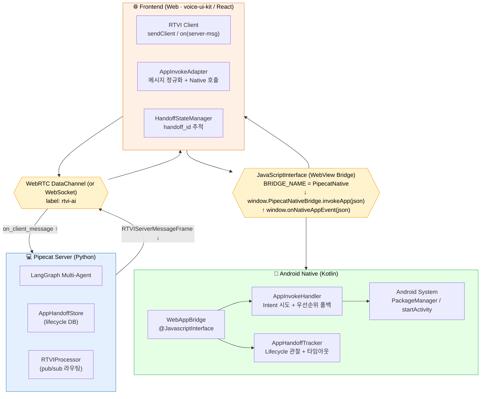
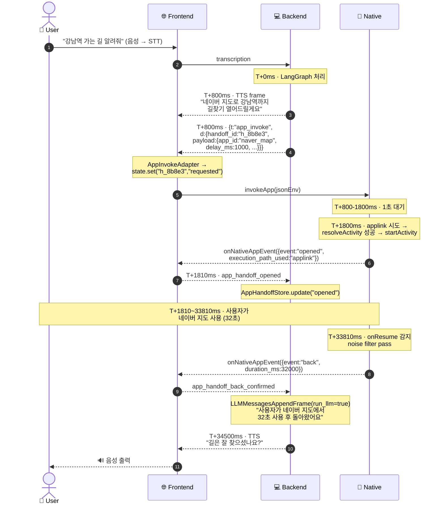
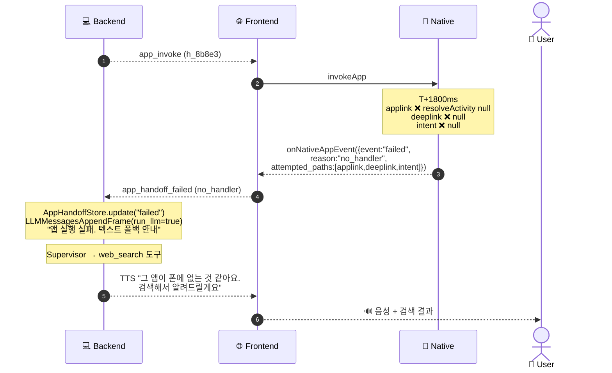
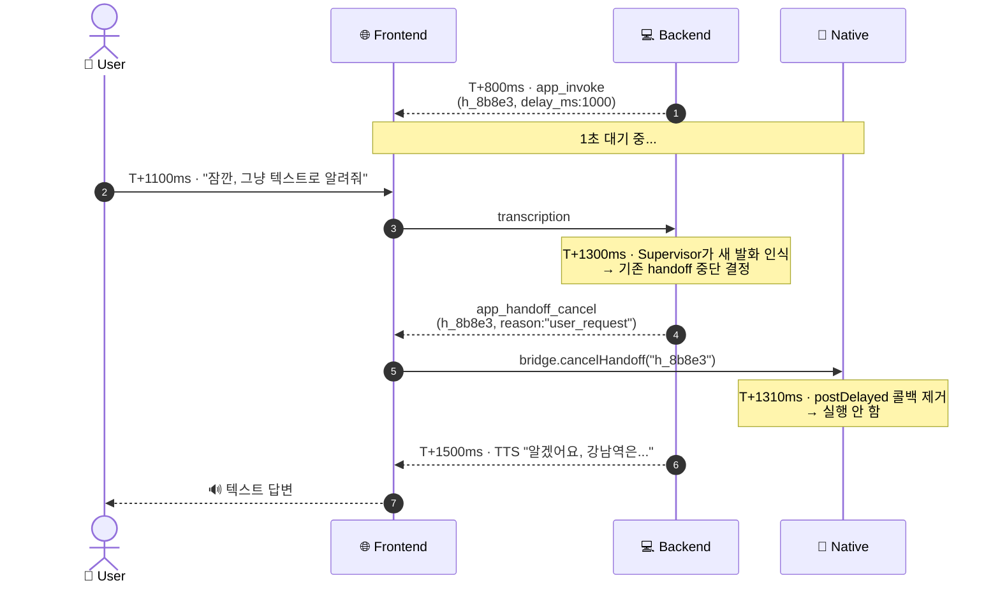

# AppConcierge — 4-Layer 통신 프로토콜 명세

> **AppConcierge Agent 설계 문서**(`app-concierge-agent-design.md`)의 부속 문서.
> Backend ↔ Frontend(Web) ↔ JS Plugin ↔ Native(Android) 4계층 사이의 메시지 봉투, 전송 채널, 책임 분리, 에러/타임아웃 정책을 정의한다.
>
> **문서 버전**: 0.1 (2026-04-27 초안)

---

## 1. 전체 그림

### 1.1 4계층 토폴로지



### 1.2 계층별 책임 매트릭스

| 계층 | 책임 | NOT 책임 (다른 층에 위임) |
|------|------|-------------------------|
| **Backend** | 앱 선택, 파라미터 추출, deeplink 템플릿 조립, handoff_id 발급, lifecycle 기록, LLM 안내문 생성 | 실행 경로별 fallback, 사용자 음성 안내 재생 (TTS는 Backend가 해도 클라가 재생), Intent 결과 판정 |
| **Frontend (Web)** | RTVI 메시지 ↔ 네이티브 브릿지 변환, handoff_id 메모리 관리, 네이티브 이벤트 → 서버 RTVI 송신 | Intent 시도 자체 (네이티브가), deeplink URL 재해석, 카탈로그 보유 |
| **JS Plugin** | 웹 ↔ 네이티브 사이 봉투 직렬화, 비동기 callback id 관리, 단일 진입점 노출 | 비즈니스 판단, 메시지 의미 해석 |
| **Native** | execution_paths 우선순위 시도, PackageManager 조회, Intent dispatch, foreground/background lifecycle 추적, 결과/실패 통보 | 어떤 앱을 열지 결정, 사용자에게 음성으로 말하기 |

---

## 2. 채널·전송 모델

| 구간 | 채널 | 직렬화 | 신뢰성 | 순서 보장 |
|------|------|--------|--------|---------|
| Backend ↔ Frontend | RTVI over WebRTC DataChannel (fallback: WebSocket) | JSON UTF-8 | reliable channel 사용 | 보장 (단일 채널) |
| Frontend ↔ JS Plugin | `window.PipecatNativeBridge.*` (JS 함수 호출) | JSON 문자열 | 동기 호출 + 비동기 콜백 | 호출 순서 = 전달 순서 |
| JS Plugin ↔ Native | `@JavascriptInterface` (JS→Native) + `webView.evaluateJavascript` (Native→JS) | JSON 문자열 | 동기 호출 (호출 자체) | 호출 순서 = 전달 순서 |
| Native ↔ Android System | `Intent` / `PackageManager` | OS 표준 | best-effort | - |

**핵심 원칙**:
- **상관 ID는 백엔드가 발급**한 `handoff_id`(uuid4) 단 하나로 4계층을 관통한다.
- 모든 메시지는 `{ "v": 1, "type": "<...>", "handoff_id": "...", "payload": {...}, "ts": "<ISO8601>" }` 봉투를 갖는다.
- 응답이 필요한 호출(예: AskUser)은 `correlation_id` 필드를 추가하고, 응답 메시지는 같은 `correlation_id`를 echo한다.

---

## 3. 메시지 봉투 (공통 envelope)

### 3.1 표준 봉투

```jsonc
{
  "v": 1,                                  // 프로토콜 메이저 버전 (breaking change 시 +1)
  "type": "app_invoke",                    // §4 메시지 타입 카탈로그 참조
  "handoff_id": "8b8e3a4f-...-uuid",       // §3.2 참조
  "correlation_id": "ask_001",             // optional: 요청-응답 매칭용 (없으면 fire-and-forget)
  "ts": "2026-04-27T10:00:00.123Z",        // 송신 측 타임스탬프
  "payload": { ... }                       // 타입별 본문 (§4)
}
```

### 3.2 handoff_id 발급 규칙

- **발급자**: Backend (`AppInvokeNode`가 deeplink를 푸시하는 시점에 `uuid4()`).
- **수명**: `requested → opened → returned | cancelled | timeout | failed` 가 종결될 때까지.
- **저장 위치**:
  - Backend: `AppHandoffStore` (세션 인메모리 + 향후 영속).
  - Frontend: `HandoffStateManager` (in-memory `Map<handoff_id, state>`).
  - Native: `AppHandoffTracker.activeHandoffs: Map<String, HandoffMeta>`.
- **클라이언트가 송신하는 모든 후속 메시지**(`app_handoff_opened` 등)는 반드시 동일 handoff_id를 echo한다.
- 미알려진 handoff_id로 도착한 클라이언트 메시지는 backend가 `handoff_unknown` 에러로 응답한다 (drop 금지 — 디버깅).

### 3.3 RTVI 봉투와의 매핑

기존 RTVI 메시지 표준과 맞물리도록 다음과 같이 wrap한다.

**Backend → Frontend** (`RTVIServerMessageFrame`로 송신):
```jsonc
{
  "label": "rtvi-ai",
  "type": "server-message",
  "id": "<rtvi-msg-id>",
  "data": {
    "v": 1,
    "type": "app_invoke",
    "handoff_id": "...",
    "ts": "...",
    "payload": { ... }
  }
}
```

**Frontend → Backend** (`sendClientMessage(type, data)`):
```jsonc
{
  "label": "rtvi-ai",
  "type": "client-message",
  "id": "<rtvi-msg-id>",
  "data": {
    "t": "app_handoff_opened",          // 기존 RTVI compact 형식
    "d": {
      "v": 1,
      "handoff_id": "...",
      "ts": "...",
      "payload": { ... }
    }
  }
}
```

> 기존 `webview_handoff_*` 메시지와 동일한 RTVI 패턴이며, **AppConcierge 전용 `t` 값(접두 `app_*`)** 을 추가한다.

---

## 4. 메시지 타입 카탈로그

### 4.1 방향별 요약

| 방향 | type | 용도 | 응답 필요 |
|------|------|------|---------|
| BE → FE | `app_invoke` | 앱 실행 명령 | (X) lifecycle 이벤트로 갈음 |
| BE → FE | `app_handoff_cancel` | 진행 중 handoff 취소 (예: 사용자가 도중에 다른 발화) | (X) |
| BE → FE | `app_invoke_ask` | 사용자에게 음성으로 되묻기 시작 (선택형) | (O) `app_invoke_ask_reply` |
| FE → BE | `app_handoff_opened` | 앱 실행 성공 통보 | (X) |
| FE → BE | `app_handoff_back_confirmed` | 사용자 복귀 확정 | (X) → BE가 LLM 재실행 |
| FE → BE | `app_handoff_failed` | 실행 실패 (no_handler / cancelled / permission_denied) | (X) |
| FE → BE | `app_handoff_timeout` | 클라 측 타임아웃 (네이티브가 5분 내 onResume 못 잡음) | (X) |
| FE → BE | `app_invoke_ask_reply` | AskUser 응답 | (-) |
| FE → Native | `bridge.invokeApp(json)` | 네이티브에 실행 위임 | callback |
| Native → FE | `onNativeAppEvent(json)` | opened/failed/back 통보 | (X) |

### 4.2 메시지 상세

#### 4.2.1 `app_invoke` (BE → FE)

```jsonc
{
  "v": 1,
  "type": "app_invoke",
  "handoff_id": "8b8e3...-uuid",
  "ts": "2026-04-27T10:00:00.000Z",
  "payload": {
    "app_id": "naver_map",
    "display_name": "네이버 지도",
    "package_name": "com.nhn.android.nmap",
    "execution_paths": [
      {
        "type": "applink",
        "priority": 1,
        "uri": "https://map.naver.com/v5/search/%EA%B0%95%EB%82%A8%EC%97%AD"
      },
      {
        "type": "deeplink",
        "priority": 2,
        "uri": "nmap://search?query=%EA%B0%95%EB%82%A8%EC%97%AD&appname=com.example.voice"
      },
      {
        "type": "intent",
        "priority": 3,
        "action": "android.intent.action.VIEW",
        "uri": "geo:0,0?q=%EA%B0%95%EB%82%A8%EC%97%AD",
        "extras": {}
      }
    ],
    "delay_ms": 1000,
    "spoken_intro": "네이버 지도로 강남역까지 길찾기 열어드릴게요.",
    "spoken_intro_dispatched_via_tts": true,
    "timeout_ms": 300000,
    "tracking": {
      "track_resume": true,
      "track_screenshot_on_return": false
    }
  }
}
```

**필드 설명**:

| 필드 | 의미 |
|------|------|
| `execution_paths` | priority 오름차순. 네이티브는 1→2→3 순으로 시도. URL은 **이미 인코딩된 상태** (BE가 책임). |
| `delay_ms` | 음성 안내 후 실행까지의 지연. 사용자 취소 여유. |
| `spoken_intro_dispatched_via_tts` | true면 BE가 이미 TTS frame을 push한 상태 — 클라는 추가 안내 X. false면 클라가 자체 음성 출력. |
| `tracking.track_resume` | true면 native가 우리 앱 onResume까지 추적 (back_confirmed 발사). |
| `tracking.track_screenshot_on_return` | true면 복귀 시 스크린샷도 같이 보고 (handoff와 동일 메커니즘). |

#### 4.2.2 `app_handoff_opened` (FE → BE)

```jsonc
{
  "v": 1,
  "type": "app_handoff_opened",
  "handoff_id": "8b8e3...-uuid",
  "ts": "2026-04-27T10:00:01.250Z",
  "payload": {
    "execution_path_used": "applink",   // 실제로 성공한 경로 타입
    "resolved_package": "com.nhn.android.nmap",  // 실행된 앱 (Intent.resolveActivity 결과)
    "delay_consumed_ms": 1000
  }
}
```

#### 4.2.3 `app_handoff_back_confirmed` (FE → BE)

```jsonc
{
  "v": 1,
  "type": "app_handoff_back_confirmed",
  "handoff_id": "8b8e3...-uuid",
  "ts": "2026-04-27T10:00:33.500Z",
  "payload": {
    "duration_ms": 32250,
    "return_kind": "auto_resume",       // "auto_resume" | "user_button" | "back_button"
    "screenshot_base64": null,          // request 시 track_screenshot_on_return=true 일 때만
    "screenshot_uri": null,             // FileProvider URI (대용량 스크린샷일 때)
    "user_summary": null                // 향후 음성 요약 받을 때 채움 ("메시지 보냈어")
  }
}
```

#### 4.2.4 `app_handoff_failed` (FE → BE)

```jsonc
{
  "v": 1,
  "type": "app_handoff_failed",
  "handoff_id": "8b8e3...-uuid",
  "ts": "2026-04-27T10:00:01.300Z",
  "payload": {
    "reason": "no_handler",
    // "no_handler" | "user_cancelled" | "permission_denied"
    // | "activity_not_found" | "bridge_error" | "invalid_uri"
    "details": "All execution_paths returned null from resolveActivity",
    "attempted_paths": ["applink", "deeplink", "intent"]
  }
}
```

#### 4.2.5 `app_handoff_timeout` (FE → BE)

```jsonc
{
  "v": 1,
  "type": "app_handoff_timeout",
  "handoff_id": "8b8e3...-uuid",
  "ts": "2026-04-27T10:05:01.000Z",
  "payload": {
    "elapsed_ms": 300000,
    "last_known_state": "opened"     // 어디까지 갔다가 타임아웃됐는지
  }
}
```

#### 4.2.6 `app_handoff_cancel` (BE → FE)

세션 도중 사용자가 다른 명령을 하거나, AppConcierge가 재시도하는 경우.

```jsonc
{
  "v": 1,
  "type": "app_handoff_cancel",
  "handoff_id": "8b8e3...-uuid",
  "ts": "2026-04-27T10:00:00.500Z",
  "payload": {
    "reason": "superseded_by_new_invoke" // | "user_request" | "session_end"
  }
}
```

클라이언트는 native에 `cancelTracking(handoff_id)`을 호출하고 더 이상 lifecycle 이벤트를 송신하지 않는다.

#### 4.2.7 `app_invoke_ask` / `app_invoke_ask_reply` (양방향)

AppConcierge LLM이 "네이버지도, 티맵 중 어느 것?"처럼 되묻고 싶을 때.

```jsonc
// BE → FE
{
  "v": 1,
  "type": "app_invoke_ask",
  "handoff_id": "8b8e3...-uuid",
  "correlation_id": "ask_001",
  "ts": "...",
  "payload": {
    "ask_kind": "choose_app",        // "choose_app" | "missing_param"
    "question": "네이버 지도, 티맵 중 어느 걸로 열까요?",
    "candidates": [
      {"id": "naver_map", "label": "네이버 지도"},
      {"id": "tmap",      "label": "티맵"}
    ]
  }
}
```

> **참고**: 사용자 음성 응답은 STT를 거쳐 일반 user message로 다시 들어오므로, `app_invoke_ask_reply`는 **선택사항**(UI 상에서 버튼 클릭 등으로 답할 때만 사용). 보이스 우선 UX에서는 LangGraph가 다음 user turn을 그냥 기다리면 된다.

---

## 5. Frontend ↔ JS Plugin 인터페이스

### 5.1 Web → Native API

전역 객체 `window.PipecatNativeBridge`를 통해 호출한다. 네이티브에서 `WebAppBridge.kt`가 `@JavascriptInterface`로 메서드를 노출한다.

```typescript
// 웹 측 타입 정의 (voice-ui-kit/src/native/bridge.ts 또는 동등 위치 신설)

interface PipecatNativeBridge {
  /** 앱 실행 위임. callback_id 자동 생성 후 onNativeAppEvent로 결과 옴. */
  invokeApp(jsonEnvelope: string): void;

  /** 진행 중 handoff 추적 취소 */
  cancelHandoff(handoffId: string): void;

  /** 현재 우리 앱이 foreground인지 즉시 조회 (sync). 디버깅용. */
  isForeground(): boolean;

  /** 브릿지 버전. 호환성 검사용. */
  getBridgeVersion(): string;  // "1.0.0"
}

declare global {
  interface Window {
    PipecatNativeBridge?: PipecatNativeBridge;
    /** Native가 호출하는 콜백. JSON 문자열로 옴. */
    onNativeAppEvent?: (jsonEnvelope: string) => void;
  }
}
```

### 5.2 Native → Web 콜백 (evaluateJavascript)

네이티브는 다음 형식으로 웹에 통보:

```javascript
// Native가 webView.evaluateJavascript()로 실행하는 코드
window.onNativeAppEvent(JSON.stringify({
  v: 1,
  type: "native_app_event",
  handoff_id: "...",
  ts: "...",
  payload: {
    event: "opened" | "failed" | "back" | "timeout" | "cancelled",
    /* event별 필드 */
  }
}));
```

웹은 `event` 값에 따라 §4.2의 RTVI 메시지로 변환해 백엔드로 송신.

### 5.3 메시지 변환 어댑터 (Frontend 책임)

```typescript
// AppInvokeAdapter — 단방향 변환만 책임

class AppInvokeAdapter {
  constructor(
    private rtvi: RTVIClient,
    private bridge: PipecatNativeBridge,
    private state: HandoffStateManager,
  ) {
    rtvi.on("server-message", this.onServerMessage);
    window.onNativeAppEvent = this.onNativeEvent;
  }

  // BE → Native 변환
  private onServerMessage = (msg: ServerMessage) => {
    const data = msg.data;
    if (data.type === "app_invoke") {
      this.state.set(data.handoff_id, "requested");
      this.bridge.invokeApp(JSON.stringify(data));
    } else if (data.type === "app_handoff_cancel") {
      this.bridge.cancelHandoff(data.handoff_id);
      this.state.delete(data.handoff_id);
    } else if (data.type === "app_invoke_ask") {
      // UI에 chip/dialog 표시 (이번 단계에서는 음성 응답 위주이므로 optional)
    }
  };

  // Native → BE 변환
  private onNativeEvent = (json: string) => {
    const env = JSON.parse(json);
    const { event, ...rest } = env.payload;
    const map: Record<string, string> = {
      opened: "app_handoff_opened",
      failed: "app_handoff_failed",
      back: "app_handoff_back_confirmed",
      timeout: "app_handoff_timeout",
    };
    const rtviType = map[event];
    if (!rtviType) return;

    this.state.set(env.handoff_id, event);
    this.rtvi.sendClientMessage(rtviType, {
      v: 1,
      handoff_id: env.handoff_id,
      ts: new Date().toISOString(),
      payload: rest,
    });
  };
}
```

### 5.4 HandoffStateManager (Frontend)

웹은 backend의 진실(source of truth)을 보조하는 캐시만 둔다.

```typescript
type HandoffPhase =
  | "requested" | "opened" | "returned"
  | "cancelled" | "timeout" | "failed";

interface HandoffState {
  handoffId: string;
  phase: HandoffPhase;
  appId: string;
  startedAt: number;
  updatedAt: number;
}

class HandoffStateManager {
  private map = new Map<string, HandoffState>();
  // set / get / delete / list / pruneOlderThan(ms)
}
```

목적: 동일 handoff에 대한 중복 이벤트 방지, 디버그 UI 표출, 세션 정리.

---

## 6. JS Plugin ↔ Native 상세

### 6.1 JavascriptInterface 등록

```kotlin
// WebAppBridge.kt 또는 신규 PipecatNativeBridge.kt
class PipecatNativeBridge(
    private val invokeHandler: AppInvokeHandler,
    private val tracker: AppHandoffTracker,
    private val webViewRef: WeakReference<WebView>,
) {
    @JavascriptInterface
    fun invokeApp(jsonEnvelope: String) {
        // 메인 스레드와 분리 — Bridge는 별도 worker thread에서 호출됨
        val env = AppInvokeEnvelope.fromJson(jsonEnvelope)
        invokeHandler.dispatch(env) { result ->
            sendEventToWeb(env.handoffId, result)
        }
    }

    @JavascriptInterface
    fun cancelHandoff(handoffId: String) {
        tracker.cancel(handoffId)
    }

    @JavascriptInterface
    fun isForeground(): Boolean = ProcessLifecycleOwner.get()
        .lifecycle.currentState.isAtLeast(Lifecycle.State.RESUMED)

    @JavascriptInterface
    fun getBridgeVersion(): String = "1.0.0"

    private fun sendEventToWeb(handoffId: String, result: NativeAppEvent) {
        val webView = webViewRef.get() ?: return
        val js = """
            window.onNativeAppEvent && window.onNativeAppEvent(${result.toJsLiteral()});
        """.trimIndent()
        webView.post { webView.evaluateJavascript(js, null) }
    }
}

// 등록
webView.addJavascriptInterface(pipecatBridge, "PipecatNativeBridge")
```

### 6.2 Native 측 데이터 클래스

```kotlin
data class AppInvokeEnvelope(
    val v: Int,
    val type: String,            // "app_invoke"
    val handoffId: String,
    val ts: String,
    val payload: AppInvokePayload,
)

data class AppInvokePayload(
    val appId: String,
    val displayName: String,
    val packageName: String,
    val executionPaths: List<ExecutionPath>,
    val delayMs: Long,
    val spokenIntro: String,
    val spokenIntroDispatchedViaTts: Boolean,
    val timeoutMs: Long,
    val tracking: TrackingOptions,
)

data class ExecutionPath(
    val type: String,            // applink|deeplink|intent|scheme|universal_link
    val priority: Int,
    val uri: String?,
    val action: String?,
    val extras: Map<String, String>?,
)

sealed class NativeAppEvent {
    abstract val event: String
    data class Opened(val executionPathUsed: String, val resolvedPackage: String) : NativeAppEvent() {
        override val event = "opened"
    }
    data class Failed(val reason: String, val details: String?, val attemptedPaths: List<String>) : NativeAppEvent() {
        override val event = "failed"
    }
    data class Back(val durationMs: Long, val returnKind: String, val screenshotBase64: String?) : NativeAppEvent() {
        override val event = "back"
    }
    data class Timeout(val elapsedMs: Long, val lastKnownState: String) : NativeAppEvent() {
        override val event = "timeout"
    }
}
```

### 6.3 AppInvokeHandler — 실행 경로 시도

```kotlin
class AppInvokeHandler(
    private val context: Context,
    private val tracker: AppHandoffTracker,
) {
    fun dispatch(env: AppInvokeEnvelope, onResult: (NativeAppEvent) -> Unit) {
        // 1. delayMs 만큼 대기 (사용자 취소 여유)
        Handler(Looper.getMainLooper()).postDelayed({
            val attempted = mutableListOf<String>()
            for (path in env.payload.executionPaths.sortedBy { it.priority }) {
                attempted += path.type
                val result = tryPath(path, env.payload.packageName)
                if (result != null) {
                    tracker.start(env.handoffId, env.payload, result)
                    onResult(NativeAppEvent.Opened(path.type, result))
                    return@postDelayed
                }
            }
            onResult(NativeAppEvent.Failed("no_handler", null, attempted))
        }, env.payload.delayMs)
    }

    private fun tryPath(path: ExecutionPath, preferredPackage: String): String? {
        return try {
            val intent = when (path.type) {
                "applink", "universal_link", "deeplink", "scheme" ->
                    Intent(Intent.ACTION_VIEW, Uri.parse(path.uri)).apply {
                        addFlags(Intent.FLAG_ACTIVITY_NEW_TASK)
                    }
                "intent" ->
                    Intent(path.action).apply {
                        path.uri?.let { data = Uri.parse(it) }
                        path.extras?.forEach { (k, v) -> putExtra(k, v) }
                        addFlags(Intent.FLAG_ACTIVITY_NEW_TASK)
                    }
                else -> return null
            }
            val resolved = intent.resolveActivity(context.packageManager) ?: return null
            // preferredPackage 와 일치하면 setPackage로 강제
            if (resolved.packageName == preferredPackage) {
                intent.setPackage(preferredPackage)
            }
            context.startActivity(intent)
            resolved.packageName
        } catch (e: Exception) {
            Log.w("AppInvokeHandler", "Path ${path.type} failed: ${e.message}")
            null
        }
    }
}
```

### 6.4 AppHandoffTracker — 복귀 감지

```kotlin
class AppHandoffTracker(
    private val processLifecycle: Lifecycle,
    private val onEvent: (String, NativeAppEvent) -> Unit,  // (handoffId, event)
) : DefaultLifecycleObserver {
    private data class Active(val payload: AppInvokePayload, val openedAt: Long, val resolvedPackage: String)
    private val active = ConcurrentHashMap<String, Active>()
    private val timeoutHandlers = ConcurrentHashMap<String, Runnable>()
    private val mainHandler = Handler(Looper.getMainLooper())

    init { processLifecycle.addObserver(this) }

    fun start(handoffId: String, payload: AppInvokePayload, resolvedPackage: String) {
        active[handoffId] = Active(payload, System.currentTimeMillis(), resolvedPackage)
        if (payload.tracking.trackResume) {
            // 타임아웃 예약
            val r = Runnable {
                if (active.containsKey(handoffId)) {
                    active.remove(handoffId)
                    onEvent(handoffId, NativeAppEvent.Timeout(payload.timeoutMs, "opened"))
                }
            }
            timeoutHandlers[handoffId] = r
            mainHandler.postDelayed(r, payload.timeoutMs)
        }
    }

    fun cancel(handoffId: String) {
        active.remove(handoffId)
        timeoutHandlers.remove(handoffId)?.let { mainHandler.removeCallbacks(it) }
    }

    override fun onResume(owner: LifecycleOwner) {
        // 우리 앱이 foreground 복귀 → 활성 handoff 모두에 back 이벤트 발사
        val now = System.currentTimeMillis()
        active.entries.toList().forEach { (id, a) ->
            if (now - a.openedAt < 2_000) return@forEach  // 자기 자신 onResume 노이즈 필터
            active.remove(id)
            timeoutHandlers.remove(id)?.let { mainHandler.removeCallbacks(it) }
            val screenshot = if (a.payload.tracking.trackScreenshotOnReturn) captureScreenshot() else null
            onEvent(id, NativeAppEvent.Back(now - a.openedAt, "auto_resume", screenshot))
        }
    }

    private fun captureScreenshot(): String? = null  // 현재 우리 화면 = 음성 UI. 분석 가치 낮음. 향후 외부 앱 잔상 캡처 시 확장.
}
```

> **노이즈 필터**: 우리 앱이 외부 앱을 띄운 직후 곧바로 onResume이 한 번 더 호출되는 케이스(또는 사용자가 즉시 백 버튼) 방지를 위해 2초 가드.

---

## 7. End-to-End 시퀀스 (메시지 단위 트레이스)

### 7.1 정상 케이스



### 7.2 실행 실패 케이스



### 7.3 사용자 취소 (도중 새 발화) 케이스



---

## 8. 에러 / 타임아웃 / 중복 정책

### 8.1 에러 코드 카탈로그

| reason | 의미 | 발생 위치 | BE 후속 처리 |
|--------|------|---------|-----------|
| `no_handler` | 모든 execution_paths가 resolveActivity null | Native | "앱이 없는 것 같아요" + 폴백 |
| `user_cancelled` | 사용자가 시스템 다이얼로그에서 취소 | Native | "취소하셨군요. 다른 도움이 필요하면 말씀해주세요." |
| `permission_denied` | 권한 거부 (드물게) | Native | 권한 안내 |
| `activity_not_found` | startActivity 도중 ActivityNotFoundException | Native | no_handler와 동일 처리 |
| `bridge_error` | JS Bridge 호출 자체 실패 (JSON 파싱 등) | FE/Native | 텍스트 폴백 |
| `invalid_uri` | URL 인코딩 결과 비정상 | Native (또는 BE 사전 검증) | 로그 + 폴백 |
| `handoff_unknown` | 알 수 없는 handoff_id로 후속 메시지 | BE | 무시하고 디버그 로그 |
| `handoff_superseded` | 새 invoke가 이전 invoke를 덮어씀 | BE → FE | cancel로 정리 |

### 8.2 타임아웃 정책

| 단계 | 타임아웃 | 기본값 | 처리 |
|------|---------|--------|------|
| BE: `app_invoke` 송신 후 `app_handoff_opened` 수신 대기 | 5초 | 5000 | timeout 시 "앱 실행이 안 되네요" |
| Native: 외부 앱 사용 후 onResume 감지 | `payload.timeout_ms` | 300000 (5분) | timeout event 발사 |
| FE: bridge 호출 후 첫 콜백 수신 대기 | 10초 | 10000 | bridge_error 자가 보고 |

### 8.3 중복·재진입 방지

- BE는 동일 세션에서 **활성 handoff가 1개**만 있도록 강제. 새 invoke 발사 시 기존 활성 handoff에 `app_handoff_cancel` 자동 전송.
- Native는 `cancelHandoff` 수신 시 `postDelayed` 콜백 제거 + tracker에서 삭제. 이미 startActivity 된 경우 되돌릴 수 없으므로 "이미 열림" 무시.
- FE는 동일 handoff에 대한 lifecycle 이벤트가 두 번 오면 두 번째는 BE에 송신하지 않고 drop.

---

## 9. 버전·호환성

### 9.1 버전 필드

- 모든 envelope에 `v: 1`. **메이저 변경**(필수 필드 제거/타입 변경) 시 +1.
- 호환되는 추가 필드는 v 유지 + 옵셔널 필드로.

### 9.2 핸드셰이크 (선택)

세션 시작 시 FE가 한 번 송신:

```jsonc
{
  "t": "client_capabilities",
  "d": {
    "protocol_versions": [1],
    "native_bridge_version": "1.0.0",   // bridge.getBridgeVersion()
    "platform": "android"
  }
}
```

BE는 지원 가능한 v를 골라 후속 메시지에 사용. 누락 시 `v=1` 가정.

### 9.3 deprecate 절차

1. 신규 type 추가 (예: `app_invoke_v2`).
2. 양측 N개월간 둘 다 송신·수신.
3. 클라 카나리에서 v2-only로 전환.
4. v1 제거.

---

## 10. 보안 고려

| 위협 | 완화 |
|------|------|
| 악성 deeplink (Open Redirect / Intent extra injection) | BE가 카탈로그 화이트리스트 기반으로만 조립. URL 인코딩 의무. Native는 받은 URI를 그대로 사용하지 말고 `Uri.parse` 후 scheme/host 화이트리스트 재검증. |
| JS Bridge 오·남용 (다른 웹사이트가 우리 WebView에 로드되면 호출 가능) | WebView는 우리 도메인만 로드. `setAllowFileAccess(false)`, CSP 헤더, BridgeName은 추측 어려운 값 사용. |
| handoff_id 위조 | BE가 발급한 ID 외에는 무시 (`handoff_unknown` 응답). |
| 스크린샷 유출 | `track_screenshot_on_return` 기본 false. 활성화 시 base64는 8KB 이하로 강제, 초과 시 FileProvider URI로. 서버는 분석 후 즉시 폐기. |
| 결제 / 송금 앱 | 현재는 동일 정책(1초 지연). 향후 risk_tier=high 도입 시 `delay_ms` 증가 + 명시 confirmation step. |

---

## 11. 관측성 (Observability)

각 메시지 송수신 시 Langfuse 또는 동등한 트레이스에 다음 키로 기록:

```
trace.session_id
trace.user_id
span.name = "app_invoke_lifecycle"
span.attrs:
  handoff_id, app_id, package_name,
  execution_path_used, attempted_paths,
  delay_ms, duration_ms,
  outcome ∈ {opened, returned, failed, timeout, cancelled},
  failure_reason
```

**유용한 운영 메트릭**:
- `app_invoke.success_rate` = opened / requested
- `app_invoke.return_rate` = returned / opened
- `app_invoke.failure_by_reason` (히스토그램)
- `app_invoke.execution_path_distribution` (applink vs deeplink vs intent)
- `app_invoke.median_in_app_duration_ms`

---

## 12. 테스트 매트릭스

| 시나리오 | BE 입력 | 기대 메시지 시퀀스 |
|---------|--------|-----------------|
| 정상 길찾기 | "강남역 가는 길" | invoke → opened(applink) → back |
| 같은 카테고리 중복 | "지도 켜줘" | invoke_ask → user reply → invoke → opened |
| 미설치 앱 | popular_default가 미설치 | invoke → failed(no_handler) → 폴백 TTS |
| 사용자 도중 취소 | "잠깐 그냥 알려줘" | invoke → cancel → 텍스트 응답 |
| Native bridge 미장착 (구버전 앱) | invoke 송신 | 5초 후 BE timeout → 폴백 |
| 5분 미복귀 | 사용자가 외부 앱에서 안 돌아옴 | invoke → opened → timeout(elapsed_ms=300000) |
| 잘못된 handoff_id | 클라가 위조 ID 송신 | BE 무시 + handoff_unknown 디버그 로그 |
| 동시 두 handoff | invoke A → invoke B (직전) | A에 cancel 자동 송신 → B만 진행 |

---

## 13. 참고 — 기존 패턴과의 매핑

| 신규 메시지 | 기존 패턴 |
|------------|---------|
| `app_invoke` | `webview_handoff_*` 의 server-message 패턴 동일 |
| `app_handoff_back_confirmed` | `webview_handoff_back_confirmed` 와 봉투/필드 명명 동일 |
| `PipecatNativeBridge.invokeApp` | `WebAppBridge` 의 plugin 시스템 확장 |
| `AppHandoffTracker.onResume` | `BaseWebViewActivity` 의 lifecycle 관찰 패턴 재사용 |
| handoff_id | 외부 핸드오프 문서의 상관 ID 컨벤션과 동일 (UUID v4) |

---

**End of protocol spec.**
