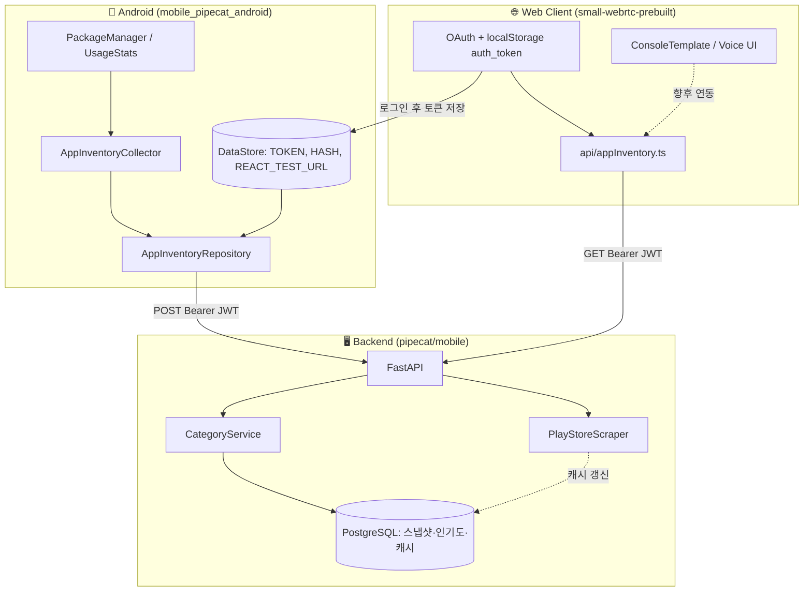
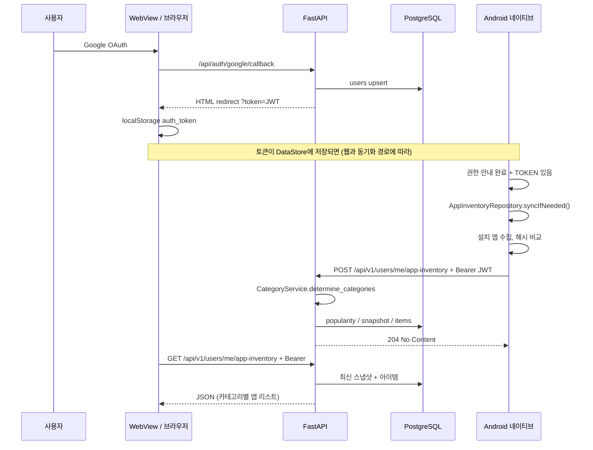
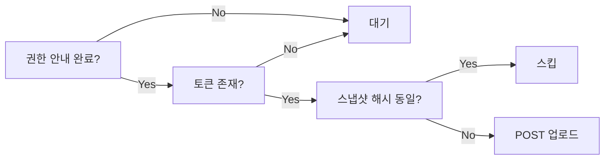
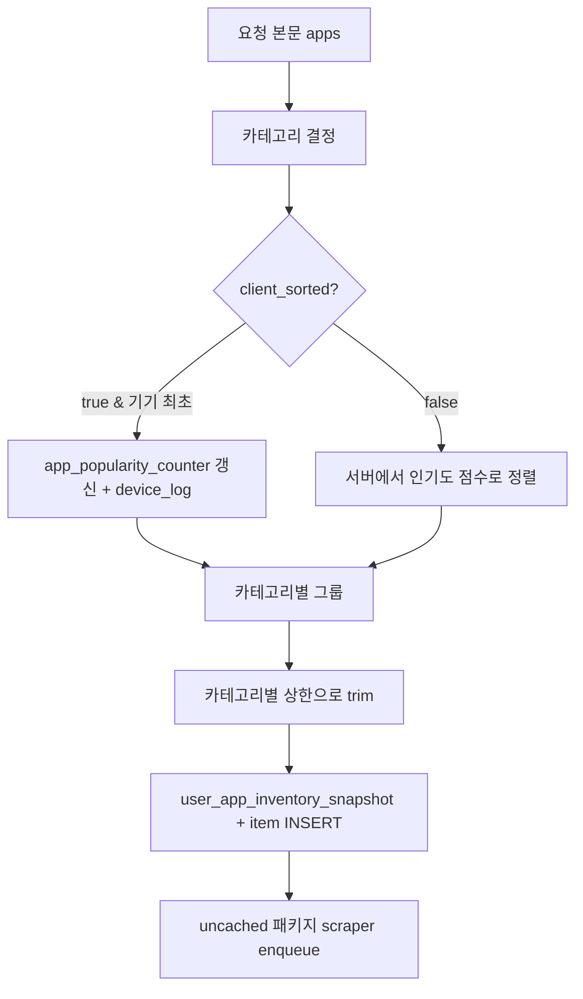
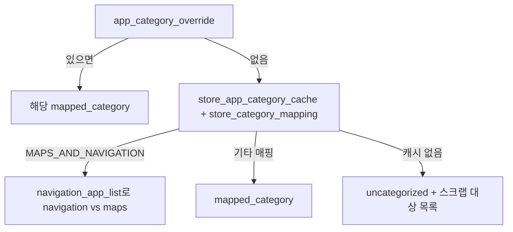
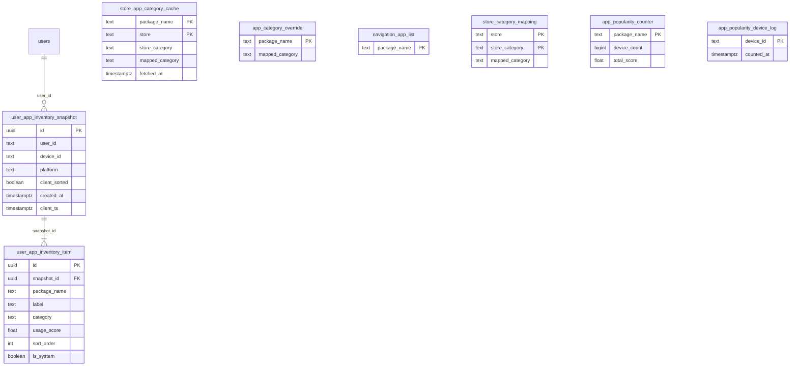

# 설치 앱 인벤토리(App Inventory) 구현 정리

Android에 설치된 앱 목록을 수집·업로드하고, 서버에서 카테고리·인기도·스냅샷으로 저장한 뒤 웹 클라이언트가 조회할 수 있도록 한 기능의 **백엔드·프론트엔드·Android** 전체 개요입니다.

---

## 1. 한눈에 보는 구조

**역할 요약**

| 레이어 | 역할 |
|--------|------|
| **Android** | 설치 앱 목록(및 선택적 사용 시간) 수집 → 동일 스냅샷이면 스킵 → `POST /api/v1/users/me/app-inventory` |
| **Backend** | JWT로 사용자 식별 → 카테고리 결정 → 인기도 집계 → 카테고리별 상한으로 스냅샷 저장 → 미캐시 패키지 스크래핑 큐 |
| **Web** | 인증 후 API 호출 가능. `fetchAppInventory`는 **준비됨**; 메인 UI는 아직 앱 목록 화면에 직접 연결하지 않을 수 있음 |

---

## 2. 전체 시퀀스 (로그인 ~ 업로드 ~ 조회)

---

## 3. Android 구현

### 3.1 트리거: 언제 업로드하는가

`CodeEngineApplication`에서 **권한 안내를 본 뒤(`SHOWN_PERMISSION_NOTICE`)** 그리고 **로그인 토큰이 있을 때(`TOKEN_KEY`)** `combine`으로 감지하여 `syncIfNeeded()`를 호출합니다.

### 3.2 주요 파일

| 파일 | 설명 |
|------|------|
| `AppInventoryCollector.kt` | `PackageManager`로 설치 앱 나열, 라벨·시스템 앱 여부. `UsageStatsManager`로 30일 foreground 시간 합산 → `usage_score` |
| `AppInventoryRepository.kt` | 토큰·`REACT_TEST_URL` 기반 API 베이스 URL, SHA-256 스냅샷 해시로 중복 업로드 방지, Retrofit POST |
| `AppInventoryApi.kt` | `POST api/v1/users/me/app-inventory` |
| `AppInventoryModels.kt` | 요청 JSON 필드 (`client_ts`, `device_id`, `platform`, `client_usage_stats_collected`, `client_sorted`, `apps[]`) |
| `AppInventoryModule.kt` | Hilt로 `AppInventoryRepository` 제공 |

### 3.3 수집 동작

- **device_id**: `Settings.Secure.ANDROID_ID`
- **사용 통계 미허용**: 전체 앱, `usage_score=null`, `client_sorted=false`
- **사용 통계 허용**: 앱별 foreground ms 합 → 내림차순 정렬, `client_sorted=true` (서버가 인기도와 함께 “클라이언트 정렬”로 처리)

### 3.4 API 베이스 URL

`DataStoreRepository`의 `REACT_TEST_URL`(웹뷰가 로드하는 React 앱 URL)에서 **scheme/host/port**만 뽑아 백엔드와 동일 호스트로 가정합니다. (예: `https://xxx.ngrok-free.app/`)

---

## 4. 백엔드 구현 (FastAPI)

### 4.1 라우트

| 메서드 | 경로 | 인증 | 설명 |
|--------|------|------|------|
| `POST` | `/api/v1/users/me/app-inventory` | Bearer JWT | 업로드, 응답 **204** |
| `GET` | `/api/v1/users/me/app-inventory` | Bearer JWT | 최신 스냅샷 + 아이템 (옵션 `?category=` ) |

등록: `auth/app_setup.py`에서 `setup_app_inventory_routes` 등.

### 4.2 POST 처리 파이프라인

### 4.3 카테고리 결정 우선순위 (`CategoryService`)

### 4.4 카테고리별 저장 상한 (`schemas.py`)

- 대부분 카테고리: **카테고리당 최대 5개** 앱만 스냅샷에 저장
- `other`, `uncategorized`: **최대 50개**

그래서 클라이언트가 800개 앱을 보내도 DB에 저장되는 행은 수십 개 수준일 수 있습니다.

### 4.5 스크래퍼 (`scraper.py`)

- `google-play-scraper` 패키지가 있으면 백그라운드 워커가 큐에서 패키지를 꺼내 Play Store 장르를 가져와 `store_app_category_cache`에 넣습니다.
- 라이브러리가 없으면 워커를 시작하지 않으며, `uncategorized`는 캐시가 쌓일 때까지 유지됩니다.

---

## 5. 프론트엔드 (small-webrtc-prebuilt)

### 5.1 인증

- OAuth 콜백 시 `?token=`을 `localStorage`에 저장 (`index.tsx`).
- `fetch` 래퍼가 `/api/` 요청에 `Authorization: Bearer`를 붙입니다.

### 5.2 앱 인벤토리 API 클라이언트

파일: `client/src/api/appInventory.ts`

- `fetchAppInventory(category?)` → `GET /api/v1/users/me/app-inventory`
- `groupByCategory(apps)` → 카테고리별 그룹핑 헬퍼

현재 메인 `App`은 로그인 후 `ConsoleTemplate`(음성 연결)을 표시하며, **앱 인벤토리 GET은 API 모듈로만 준비**되어 있고 대시보드/별도 화면에 붙이는 것은 **추가 UI 작업**으로 남을 수 있습니다.

---

## 6. 데이터베이스 모델과 관계

`app_inventory/schema.sql` 기준입니다.

---

## 7. 실제로 어떤 데이터가 쌓이는가 (예시)

아래는 **로그에서 본 것과 같은 형태**를 단순화한 예입니다. (UUID·수치는 예시)

### 7.1 OAuth 사용자 (`users`)

한 사용자가 Google로 처음 로그인하면 한 행이 생깁니다. JWT의 `sub`가 이 테이블의 `id`(UUID)입니다.

| id | provider | email | … |
|----|----------|-------|---|
| `b64ffad3-6275-412d-8651-9d6cde6c0744` | `google` | `user@example.com` | … |

**나중에 쓰임**: 모든 `user_app_inventory_snapshot.user_id`가 여기를 가리켜 “누구의 폰 스냅샷인지” 구분합니다.

### 7.2 스냅샷 헤더 (`user_app_inventory_snapshot`)

업로드 한 번마다 **append**되는 이력 행입니다.

| id | user_id | device_id | platform | client_sorted | client_ts |
|----|---------|-----------|----------|---------------|-----------|
| `fdc1db1b-9ed5-4a2f-af18-cbc5db269bed` | `b64f…744` | `ff3d21079c6fe99d` | `android` | `true` | `2026-04-01T10:02:37+09:00` |

**나중에 쓰임**: 동일 사용자·기기의 **시간에 따른 앱 구성 변화** 분석, “최근 스냅샷만” 조회 API.

### 7.3 스냅샷 아이템 (`user_app_inventory_item`)

카테고리별 상한 적용 **후**만 저장됩니다. 예: `social_chat`에서 상위 5개만.

| snapshot_id | package_name | label | category | usage_score | sort_order |
|-------------|--------------|-------|----------|-------------|------------|
| `fdc1…` | `com.kakao.talk` | 카카오톡 | `social_chat` | `1.2e8` | 0 |
| `fdc1…` | `com.whatsapp` | WhatsApp | `social_chat` | `9e7` | 1 |
| `fdc1…` | `com.google.android.apps.maps` | 지도 | `maps` | `5e7` | 10 |

**나중에 쓰임**:

- 음성 에이전트가 “사용자가 자주 쓰는 앱” 맥락으로 응답
- 카테고리 필터 UI (`GET ?category=social_chat`)
- 개인정보 최소화 시 **패키지명만** 쓰는 정책 설계

### 7.4 집단 인기도 (`app_popularity_counter`, `app_popularity_device_log`)

`client_sorted=true`이고 해당 `device_id`가 **처음** 집계될 때, 업로드된 **전체 앱 목록**으로 카운터가 올라갑니다. (스냅샷에 74개만 저장돼도 인기도는 830개 전부 반영 가능)

`app_popularity_device_log`:

| device_id | counted_at |
|-----------|------------|
| `ff3d21079c6fe99d` | `2026-04-01…` |

`app_popularity_counter` (예시):

| package_name | device_count | total_score |
|--------------|--------------|---------------|
| `com.kakao.talk` | 1523 | `1.8e9` |
| `com.android.chrome` | 1400 | `2.1e9` |

**나중에 쓰임**:

- `client_sorted=false` 업로드 시 서버가 **같은 카테고리 안에서** 인기도 순으로 정렬
- 제품 전체 “많이 깔린 앱 / 사용 점수 합 높은 앱” 통계 (익명 집계 가능)

### 7.5 스토어 캐시·매핑 (`store_app_category_cache`, `store_category_mapping`, `app_category_override`)

- **시드 데이터**: `store_category_mapping`에 Google Play 장르 → 내부 카테고리 (`COMMUNICATION` → `social_chat` 등).
- **앱별 오버라이드**: `app_category_override`에 카카오톡, 유튜브 등 알려진 패키지.
- **스크래퍼 성공 시**: `store_app_category_cache`에 `(package_name, google_play)` 행이 생기고, 다음 업로드부터 `uncategorized` 비율이 줄어듭니다.

**나중에 쓰임**: 새 앱이 많아져도 서버만 시드/스크래핑으로 카테고리 품질 유지.

### 7.6 내비게이션 분기 (`navigation_app_list`)

`MAPS_AND_NAVIGATION`인데 목록에 있으면 `navigation`, 없으면 `maps`.

**나중에 쓰임**: “내비 앱 vs 지도 앱” 뉘앙스가 다른 음성 시나리오.

---

## 8. 데이터가 “나중에” 어떻게 활용될 수 있는지

| 목적 | 활용 데이터 |
|------|-------------|
| **개인화 응답** | 최신 `user_app_inventory_item` + `usage_score` |
| **집단 트렌드 / 순위** | `app_popularity_counter` (식별자 없이 집계 가능) |
| **카테고리 품질 개선** | `uncategorized` 비율, `store_app_category_cache` 커버리지 |
| **규정·삭제** | `user_id` 단위로 스냅샷 삭제, `clear_test_data.py` 등 |
| **A/B** | `client_sorted` true/false에 따른 추천 품질 비교 |

---

## 9. 관련 경로 빠른 참조

| 구분 | 경로 |
|------|------|
| DB 스키마·시드 | `pipecat/mobile/app_inventory/schema.sql` |
| API 스키마 | `pipecat/mobile/app_inventory/schemas.py` |
| 라우트 | `pipecat/mobile/app_inventory/routes.py` |
| Android 수집·업로드 | `mobile_pipecat_android/.../appinventory/*.kt` |
| 웹 API 클라이언트 | `small-webrtc-prebuilt/client/src/api/appInventory.ts` |
| 앱 등록·라우트 연결 | `pipecat/mobile/auth/app_setup.py` |

---

*문서 생성 시점 기준 코드 구조를 반영했습니다. UI에서 `fetchAppInventory`를 호출하는 화면은 프로젝트 진행에 따라 추가될 수 있습니다.*
