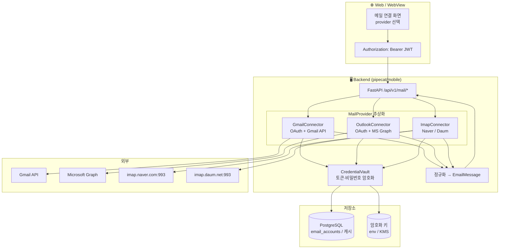
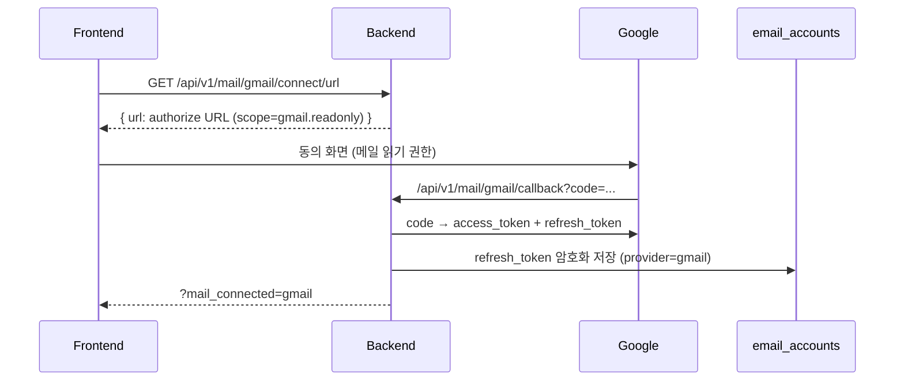
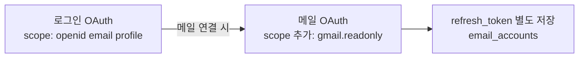
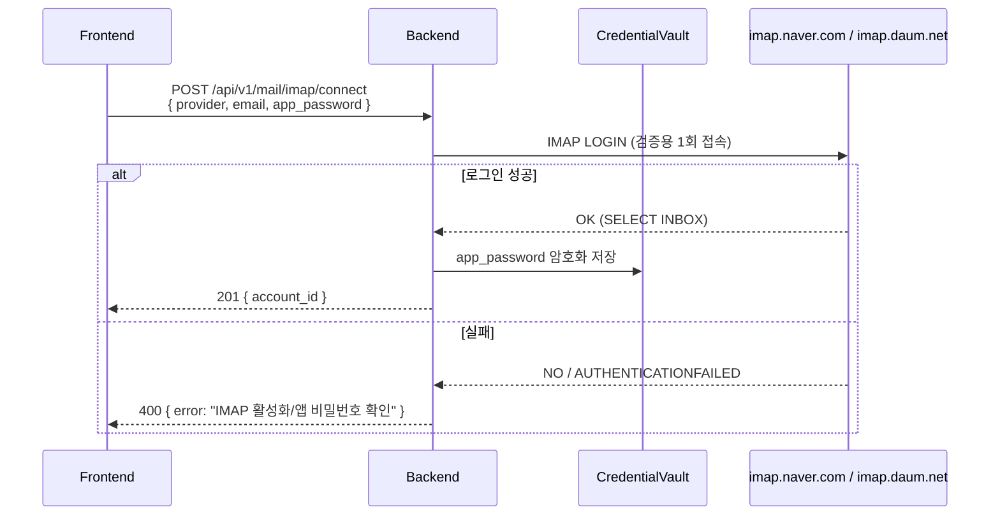
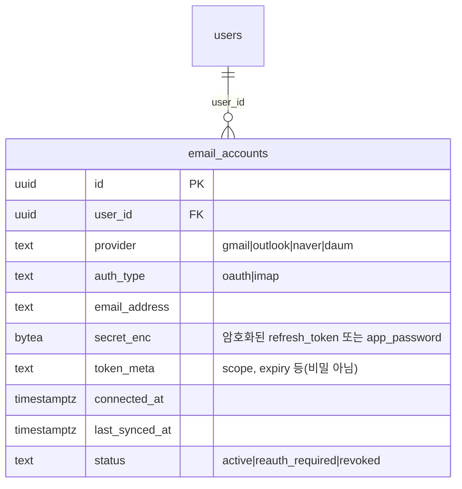
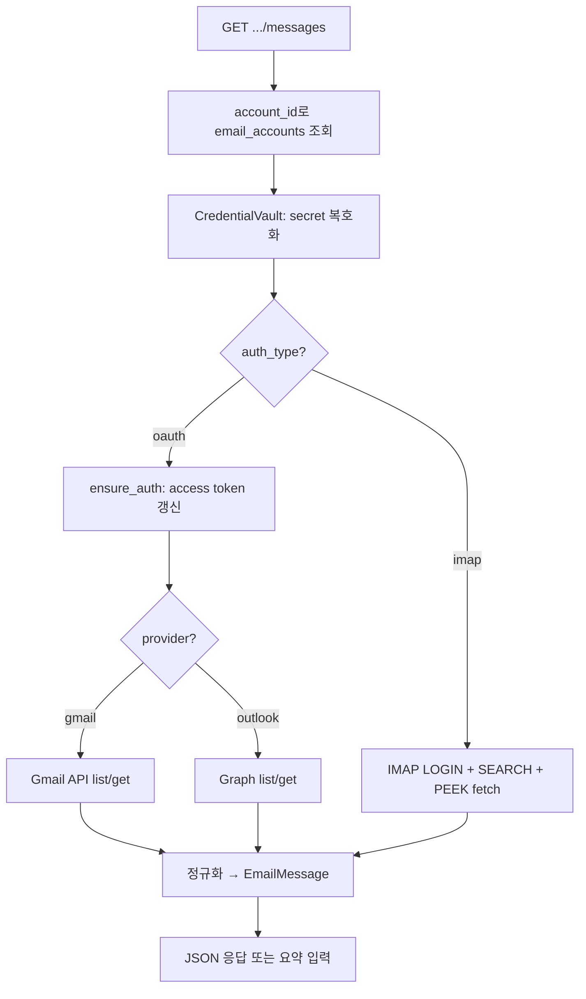

# 이메일 조회·요약을 위한 인증/수집 설계

여러 메일 제공자(Gmail·Outlook·Naver·Daum)의 메일을 **인증해서 가져오고**, 이를 LLM이 **요약**할 수 있도록 하는 백엔드 설계 문서입니다. 인증 방식이 제공자마다 다르므로 **OAuth 트랙**과 **IMAP 트랙** 두 가지로 나누어, 각 트랙의 인증 흐름·자격증명 저장·조회 API를 정리합니다.

> 범위: **메일 데이터 수집(read-only)** 까지를 다룹니다. 요약 자체는 §8에서 기존 LLM 파이프라인에 어떻게 붙는지만 개략적으로 정리합니다.

---

## 0. 왜 두 트랙인가

| 구분 | 제공자 | 인증 방식 | 데이터 접근 |
|------|--------|-----------|-------------|
| **OAuth 트랙** | **Gmail**, **Outlook** | OAuth 2.0 + 메일 scope (refresh token 보관) | REST API (Gmail API / Microsoft Graph) |
| **IMAP 트랙** | **Naver**, **Daum** | 계정 비밀번호 / **앱 비밀번호** (IMAP 활성화 필요) | IMAP4 (imaplib over SSL) |

**핵심 결정**

- Gmail·Outlook은 **메일 전용 OAuth scope**와 공식 REST API가 있어, 토큰 기반으로 안전하게(비밀번호 미보관) 조회할 수 있다. → **OAuth 트랙**
- Naver·Daum은 일반 외부 앱에 메일 읽기용 OAuth scope를 열어 주지 않는다(네이버 로그인 OAuth는 프로필용이며 메일 본문 접근 권한이 없음). 표준 **IMAP**으로 접근하며, 이때 **계정/앱 비밀번호**를 받아 보관해야 한다. → **IMAP 트랙**

> ⚠️ **중요**: 이 프로젝트에는 이미 Google/Naver/Kakao **로그인** OAuth가 있다([oauth-implementation-deep-dive.md](oauth-implementation-deep-dive.md)). 그러나 로그인 scope는 `openid email profile`뿐이라 **메일 본문을 읽을 수 없다.** 메일 수집은 **로그인과 분리된 별도의 인증·동의(consent)** 가 필요하다(§3.3).

---

## 1. 전체 아키텍처



**역할 요약**

| 레이어 | 역할 |
|--------|------|
| **Client** | 사용자가 연결할 메일 제공자를 선택. OAuth는 동의 화면으로, IMAP은 자격증명 입력 폼으로 분기. 모든 요청은 기존 로그인 JWT를 Bearer로 전달 |
| **API** | 제공자 선택 → 해당 `MailProvider` 구현으로 위임. 조회 결과는 **정규화된 `EmailMessage`** 로 반환 |
| **CredentialVault** | OAuth refresh token / IMAP 앱 비밀번호를 **암호화하여** `email_accounts`에 저장·복호화 |
| **MailProvider** | 제공자별 차이를 숨기는 공통 인터페이스(`list_messages`, `get_message`) |

---

## 2. 공통 인터페이스 (MailProvider 추상화)

제공자별 차이(OAuth vs IMAP, REST vs IMAP4)를 한 인터페이스 뒤로 숨겨, API·요약 파이프라인이 제공자에 무관하게 동작하도록 한다.

```python
class MailProvider(Protocol):
    provider: str  # "gmail" | "outlook" | "naver" | "daum"

    async def ensure_auth(self, account: EmailAccount) -> None:
        """OAuth면 access token 갱신, IMAP이면 로그인 검증."""

    async def list_messages(
        self, account: EmailAccount, *, query: MailQuery
    ) -> list[EmailSummary]:
        """헤더 레벨 목록 (from, subject, date, snippet, unread)."""

    async def get_message(
        self, account: EmailAccount, message_id: str
    ) -> EmailMessage:
        """본문 포함 단건 (text/plain 우선, html fallback)."""
```

**정규화 모델** — 어떤 제공자에서 와도 동일한 형태로 LLM·UI에 전달.

```python
class EmailSummary(BaseModel):
    message_id: str          # 제공자 내 ID (Gmail id / Graph id / IMAP UID)
    thread_id: str | None
    from_addr: str
    from_name: str | None
    subject: str
    date: datetime           # tz-aware
    snippet: str             # 본문 앞부분 미리보기
    is_unread: bool
    has_attachments: bool

class EmailMessage(EmailSummary):
    to: list[str]
    cc: list[str]
    body_text: str           # 요약 입력으로 사용하는 정규화 본문
    body_html: str | None
```

> `@dataclass`가 아니라 Pydantic `BaseModel`을 쓰는 이유: 외부 API/IMAP에서 온 데이터의 검증·직렬화 이득이 크기 때문(AGENTS.md 코드 스타일 기준 — 외부 API 데이터는 `BaseModel`).

---

## 3. OAuth 트랙 (Gmail · Outlook)

### 3.1 Gmail

| 항목 | 값 |
|------|-----|
| Authorize | `https://accounts.google.com/o/oauth2/v2/auth` |
| Token | `https://oauth2.googleapis.com/token` |
| **Scope** | `https://www.googleapis.com/auth/gmail.readonly` (+ 로그인용 `openid email`) |
| 필수 파라미터 | `access_type=offline`, `prompt=consent` (refresh token 확보) |
| 조회 API | `GET /gmail/v1/users/me/messages` (list) → `GET /gmail/v1/users/me/messages/{id}` (get) |

**인증 흐름**



**조회**

- `list`: `q` 파라미터로 검색(`is:unread`, `newer_than:7d`, `from:...`), `maxResults`로 페이지네이션(`pageToken`).
- `get`: `format=metadata`(헤더만, 목록 화면용) 또는 `format=full`(본문). 본문은 `payload.parts`에서 `text/plain`을 우선 디코드(base64url), 없으면 `text/html` → 텍스트 변환.

**운영 주의**

- `gmail.readonly`는 Google **제한된 scope(restricted scope)** 라 프로덕션 게시(검증) 시 보안 평가(CASA)가 필요. 사내/테스트 단계에서는 **테스트 사용자(Test users)** 등록으로 진행 가능.
- access token 만료(≈1h) 시 보관한 **refresh token으로 자동 재발급**(`ensure_auth`).

### 3.2 Outlook (Microsoft Graph)

| 항목 | 값 |
|------|-----|
| Authorize | `https://login.microsoftonline.com/common/oauth2/v2.0/authorize` |
| Token | `https://login.microsoftonline.com/common/oauth2/v2.0/token` |
| **Scope** | `offline_access Mail.Read User.Read` |
| 테넌트 | 개인 계정(outlook.com/hotmail) + 회사/학교 모두 지원하려면 `common` |
| 조회 API | `GET https://graph.microsoft.com/v1.0/me/messages` |

**인증 흐름은 Gmail과 동일 패턴**(authorize → callback → code 교환 → refresh token 저장). 차이점:

- Microsoft는 `offline_access`를 scope에 넣어야 refresh token이 내려온다(Google의 `access_type=offline`에 대응).
- 일부 회사 테넌트는 `Mail.Read`에 **관리자 동의(admin consent)** 가 필요할 수 있음.
- PKCE 권장(서버 비밀이 없는 SPA·모바일 흐름이면 사실상 필수).

**조회**

- `list`: `GET /me/messages?$select=id,subject,from,receivedDateTime,bodyPreview,isRead,hasAttachments&$top=25&$orderby=receivedDateTime desc`, 필터는 `$filter=isRead eq false` 등, 페이지네이션은 `@odata.nextLink`.
- `get`: `GET /me/messages/{id}` → `body.contentType`(`html`/`text`)에 따라 본문 추출.

### 3.3 기존 로그인 OAuth와의 관계 (incremental authorization)

이미 **Google 로그인**이 있는 사용자가 Gmail을 연결할 때, 메일 scope를 **추가로** 받아야 한다.



- **로그인 토큰(users)** 과 **메일 토큰(email_accounts)** 을 **분리 저장**한다. 로그인은 단발성 신원 확인이지만, 메일은 장기 보관할 refresh token이 필요하고 scope 위험도가 다르기 때문.
- Google은 `include_granted_scopes=true`로 기존 동의에 점증적으로 더할 수 있으나, 구현 단순화를 위해 **메일 연결은 독립된 별도 동의 플로우**로 두는 것을 권장(로그인 provider가 Naver/Kakao여도 Gmail 연결이 가능해야 하므로).

---

## 4. IMAP 트랙 (Naver · Daum)

OAuth 메일 scope가 없으므로 **IMAP4 over SSL**로 접근한다. 사용자는 (1) 메일 설정에서 **IMAP 사용**을 켜고, (2) 2단계 인증을 쓴다면 **앱 비밀번호**를 발급해 입력해야 한다.

| 제공자 | IMAP 호스트 | 포트 | 보안 | 사전 설정 |
|--------|-------------|------|------|-----------|
| **Naver** | `imap.naver.com` | 993 | SSL/TLS | 환경설정 → POP3/IMAP 설정 → **IMAP/SMTP 사용함** |
| **Daum** | `imap.daum.net` | 993 | SSL/TLS | 환경설정 → IMAP/POP3 → **IMAP 사용** |

> 두 제공자 모두 계정에 **2단계 인증이 켜져 있으면 일반 비밀번호로 IMAP 로그인할 수 없고**, 별도의 **앱 비밀번호**를 발급받아야 한다. 연결 폼에 이 안내를 명시한다.

**연결 흐름**



**조회 (`imaplib` / `aioimaplib`)**

```python
# 의사코드
imap = IMAP4_SSL("imap.naver.com", 993)
imap.login(email, app_password)        # 복호화한 비밀번호
imap.select("INBOX", readonly=True)    # 읽기 전용 → 읽음 표시 변경 방지
typ, data = imap.search(None, "UNSEEN")        # 또는 SINCE 7-Jun-2026
for uid in data[0].split()[-25:]:
    typ, msg = imap.fetch(uid, "(RFC822)")      # 또는 BODY.PEEK[] (읽음표시 X)
    parsed = email.message_from_bytes(msg[0][1])  # → EmailMessage 정규화
```

**IMAP 정규화 포인트**

- **message_id**: IMAP **UID** + 폴더명 조합(UID는 폴더 내에서만 유일).
- **인코딩**: `=?UTF-8?B?...?=` MIME 헤더는 `email.header.decode_header`로 디코드. Naver/Daum은 한글 제목에서 EUC-KR이 섞일 수 있으니 fallback 처리.
- **본문**: `multipart` 순회로 `text/plain` 우선, charset에 맞춰 디코드. `BODY.PEEK[]`를 써서 **읽음 상태를 바꾸지 않는다**(읽기 전용 수집 원칙).
- **연결 비용**: IMAP은 세션 기반이라 매 요청 로그인은 비싸다. **단기 커넥션 풀/캐시**를 두거나, 목록 조회 후 본문은 같은 세션에서 묶어 가져온다.

---

## 5. 자격증명 저장·보안

### 5.1 `email_accounts` 테이블



```sql
CREATE TABLE IF NOT EXISTS email_accounts (
    id UUID PRIMARY KEY DEFAULT gen_random_uuid(),
    user_id UUID NOT NULL REFERENCES users(id) ON DELETE CASCADE,
    provider VARCHAR(20) NOT NULL,           -- gmail|outlook|naver|daum
    auth_type VARCHAR(10) NOT NULL,          -- oauth|imap
    email_address VARCHAR(320) NOT NULL,
    secret_enc BYTEA NOT NULL,               -- 암호화된 refresh_token / app_password
    token_meta JSONB DEFAULT '{}'::jsonb,    -- scope, access_token_expiry 등 (비밀 아님)
    connected_at TIMESTAMPTZ DEFAULT CURRENT_TIMESTAMP,
    last_synced_at TIMESTAMPTZ,
    status VARCHAR(20) DEFAULT 'active',
    UNIQUE(user_id, provider, email_address)
);
CREATE INDEX IF NOT EXISTS idx_email_accounts_user ON email_accounts(user_id);
```

### 5.2 암호화 원칙

- **저장 시 암호화(at rest)**: refresh token·앱 비밀번호는 **평문 저장 금지**. 대칭키 암호화(예: AES-GCM, `cryptography.fernet`)로 `secret_enc`에 보관.
- **키 관리**: 암호화 키는 DB와 **분리**해 환경변수/KMS에 둔다(`MAIL_SECRET_KEY`). 키가 없으면 복호화 불가 → DB 유출만으로 메일 접근 불가.
- **access token 미보관**: 짧게 사는 access token은 메모리/캐시에만 두고, **refresh token만** 영속화한다.
- **최소 보관**: 메일 본문은 가급적 **요약 즉시 폐기**하고 원문은 장기 저장하지 않는 것을 기본 정책으로(§9). 캐시가 필요하면 TTL·암호화·사용자별 삭제 경로를 함께 설계.

### 5.3 폐기·갱신

- **연결 해제(disconnect)**: `email_accounts` 행 삭제 + (가능하면) OAuth provider에 token revoke 호출.
- **재인증 필요(reauth_required)**: refresh token 만료/철회 감지 시 status 갱신 → 클라이언트에 재연결 유도.
- 사용자 탈퇴 시 `ON DELETE CASCADE`로 메일 자격증명도 함께 삭제.

---

## 6. API 엔드포인트 설계

모든 엔드포인트는 기존 로그인 **JWT(Bearer)** 로 보호되며, 작업 대상 사용자는 JWT의 `sub`로 식별한다([README_OAUTH.md](README_OAUTH.md) 미들웨어 재사용).

| 메서드 | 경로 | 트랙 | 설명 |
|--------|------|------|------|
| `GET` | `/api/v1/mail/{provider}/connect/url` | OAuth | Gmail/Outlook 동의 URL 발급 |
| `GET` | `/api/v1/mail/{provider}/callback` | OAuth | code 교환 → refresh token 저장 |
| `POST` | `/api/v1/mail/imap/connect` | IMAP | Naver/Daum 자격증명 검증·저장 |
| `GET` | `/api/v1/mail/accounts` | 공통 | 연결된 메일 계정 목록(상태 포함) |
| `DELETE` | `/api/v1/mail/accounts/{id}` | 공통 | 연결 해제 + 자격증명 폐기 |
| `GET` | `/api/v1/mail/accounts/{id}/messages` | 공통 | 목록(쿼리: `?unread=`, `?since=`, `?q=`, `?limit=`) |
| `GET` | `/api/v1/mail/accounts/{id}/messages/{mid}` | 공통 | 단건 본문 |
| `POST` | `/api/v1/mail/accounts/{id}/summarize` | 공통 | 목록/단건 → LLM 요약(§8) |

> `{provider}`는 OAuth 트랙 전용 분기(`gmail`/`outlook`)이고, IMAP은 폼 데이터를 받으므로 단일 `POST /imap/connect`에서 `provider`를 본문으로 받는다. 조회/요약 엔드포인트는 **account_id 기반으로 트랙 무관**(MailProvider가 흡수).

**라우트 등록**: 기존 `auth/app_setup.py` 패턴을 따라 `setup_mail_routes(app)`로 묶어 연결([app-inventory-implementation.md](app-inventory-implementation.md)의 `setup_app_inventory_routes`와 동일 컨벤션).

---

## 7. 조회 흐름 한눈에 (트랙 통합)



---

## 8. 메일 → 요약 파이프라인 (LLM 연동)

수집된 `EmailMessage[]`는 기존 LLM 서비스로 넘겨 요약한다. 두 가지 진입 방식:

1. **REST 요약 엔드포인트** (`POST .../summarize`): 정규화 본문들을 한 프롬프트로 묶어 요약 응답을 반환. 단발성 화면·배치에 적합.
2. **네이티브 툴 / 음성 파이프라인 연동**: 음성 에이전트가 "오늘 안 읽은 메일 요약해줘" 같은 발화를 처리할 때, [native-app-tools-llm-integration-design.md](native-app-tools-llm-integration-design.md)의 **tools 스키마(C 방식)** 로 `summarize_mail(account_id, query)` 툴을 등록해 호출 → 본 문서의 조회 경로를 그대로 재사용.

**요약 입력 설계**

- **개인정보 최소화**: 요약에 필요한 필드(from·subject·date·body_text)만 모델에 전달. 첨부 원본·전체 헤더는 제외.
- **토큰 관리**: 메일이 많으면 (a) 먼저 헤더 레벨로 분류·우선순위 후, (b) 상위 N건만 본문 요약하는 **2단계** 구성.
- **출력 계약**: 메일별 1~2줄 요약 + 액션 필요 항목(회신·일정) 플래그를 구조화(JSON)해 UI/음성이 함께 쓸 수 있게.

---

## 9. 보안·프라이버시 고려사항

| 항목 | 정책 |
|------|------|
| **자격증명 암호화** | refresh token·앱 비밀번호 AES-GCM 등으로 암호화 저장, 키는 KMS/env 분리 |
| **읽기 전용** | OAuth는 `*.readonly` scope, IMAP은 `readonly=True`/`BODY.PEEK`로 원본 상태 불변 |
| **최소 권한** | Gmail `gmail.readonly`, Graph `Mail.Read`만 요청(전송·수정 scope 미요청) |
| **본문 비영속** | 요약 후 본문 폐기 기본. 캐시 시 TTL·암호화·사용자 삭제 경로 필수 |
| **전송 구간** | 모든 외부 연결 TLS. IMAP은 993(SSL) 강제 |
| **권한 철회 대응** | revoke/만료 감지 → `status=reauth_required` → 재연결 유도 |
| **삭제 권리** | 계정 단위(`DELETE /accounts/{id}`)·사용자 단위(CASCADE) 폐기 경로 제공 |
| **회사망(MITM)** | 사내 SSL 검사 환경에서 외부 IMAP/HTTPS 인증서 오류 가능 — 도구별 truststore 설정 참고(메모리: 회사망 SSL 검사) |

---

## 10. 단계별 구현 계획

### 단계 1 — 공통 기반
- [ ] `email_accounts` 스키마 + `CredentialVault`(암호화/복호화) 구현
- [ ] `MailProvider` 인터페이스 + `EmailSummary`/`EmailMessage` 정규화 모델
- [ ] `setup_mail_routes` + `/accounts`, `/accounts/{id}` (CRUD·상태)

### 단계 2 — IMAP 트랙 (먼저, 외부 검증 부담 적음)
- [ ] `ImapConnector`(Naver/Daum), `POST /imap/connect` 검증 플로우
- [ ] 목록/단건 조회 + 한글 인코딩(EUC-KR fallback)·`BODY.PEEK` 처리

### 단계 3 — OAuth 트랙
- [ ] `GmailConnector` (authorize/callback, refresh token, Gmail API)
- [ ] `OutlookConnector` (MS Graph, `common` 테넌트, `offline_access`)
- [ ] access token 자동 갱신(`ensure_auth`)

### 단계 4 — 요약·연동
- [ ] `POST .../summarize` + 2단계(헤더 분류 → 상위 N 본문 요약)
- [ ] (선택) 음성 파이프라인 `summarize_mail` 툴 등록

### 단계 5 — 운영
- [ ] revoke/만료 감지, 재인증 UX
- [ ] Gmail restricted scope 검증(CASA) 또는 테스트 사용자 운영 결정

---

## 11. 실패 모드와 완화

| 실패 | 원인 | 완화 |
|------|------|------|
| IMAP `AUTHENTICATIONFAILED` | IMAP 미활성 / 2FA에 일반 비번 사용 | 연결 폼에 "IMAP 켜기 + 앱 비밀번호" 안내, 명확한 에러 메시지 |
| OAuth refresh token 없음 | `access_type=offline`/`offline_access` 누락, 재동의 시 미발급 | `prompt=consent`로 강제 재동의, 토큰 누락 시 재연결 |
| Gmail scope 거부(미검증 앱) | restricted scope 검증 전 | 테스트 사용자 등록 / 검증 완료 후 게시 |
| Graph `403`(테넌트) | 회사 테넌트 admin consent 필요 | 관리자 동의 안내 또는 개인 계정 우선 지원 |
| 한글 제목 깨짐 | EUC-KR/MIME 인코딩 | `decode_header` + charset fallback |
| 토큰 만료 중 조회 | access token 1h 만료 | `ensure_auth`에서 선제 갱신, 401 시 1회 재시도 |

---

## 12. 빠른 참조

| 구분 | 값 |
|------|-----|
| Gmail scope | `https://www.googleapis.com/auth/gmail.readonly` |
| Gmail API | `GET /gmail/v1/users/me/messages[/{id}]` |
| Outlook scope | `offline_access Mail.Read User.Read` |
| Graph API | `GET https://graph.microsoft.com/v1.0/me/messages` |
| Naver IMAP | `imap.naver.com:993` (SSL), IMAP 사용 설정 필요 |
| Daum IMAP | `imap.daum.net:993` (SSL), IMAP 사용 설정 필요 |
| 자격증명 테이블 | `email_accounts` (암호화 `secret_enc`) |
| 라우트 등록 | `auth/app_setup.py` → `setup_mail_routes` |

---

*이 문서는 인증·수집 설계의 기준안입니다. 구체 구현(파일·클래스)은 단계별 진행에 따라 추가됩니다. 기존 로그인 OAuth 인프라([oauth-implementation-deep-dive.md](oauth-implementation-deep-dive.md))를 재사용하되, **메일 접근은 로그인과 분리된 별도 동의·자격증명**으로 다룹니다.*
</content>
</invoke>
