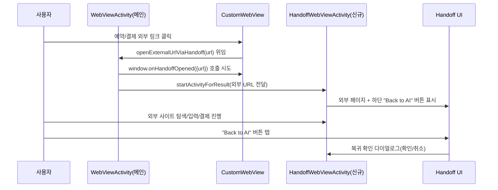
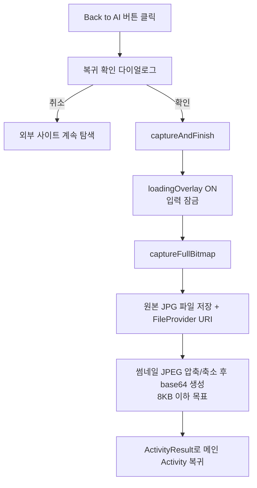
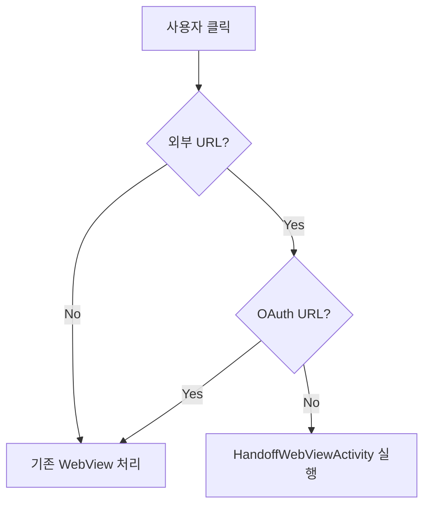
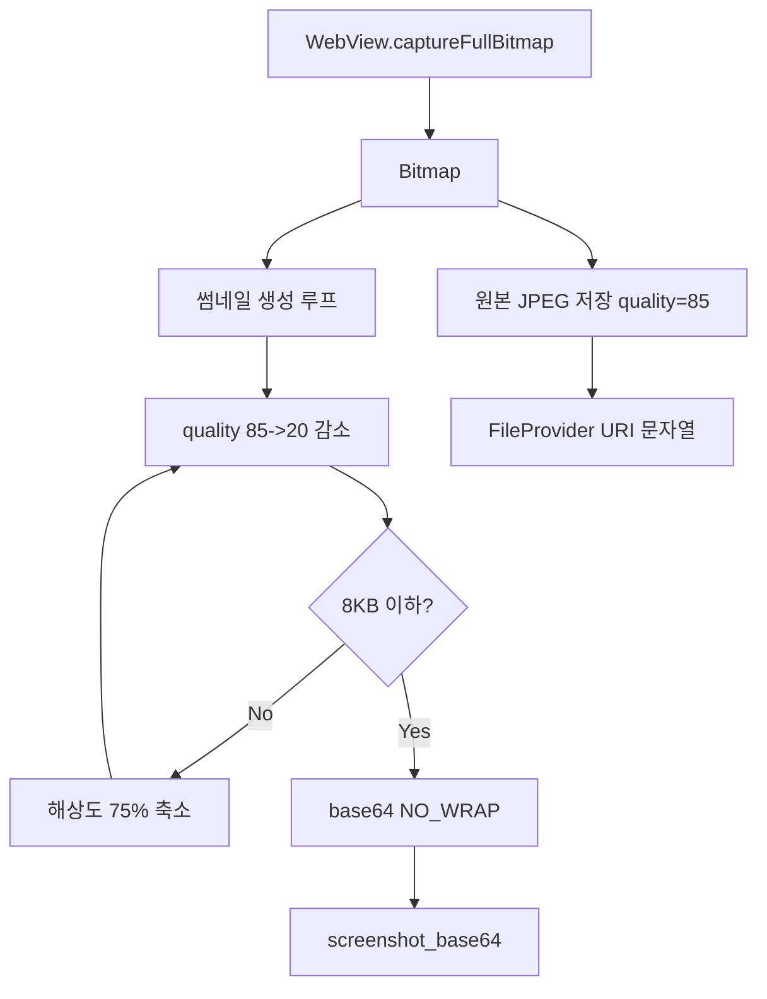
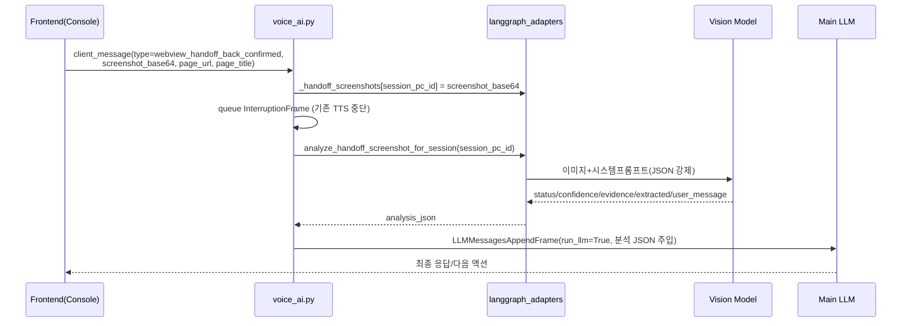
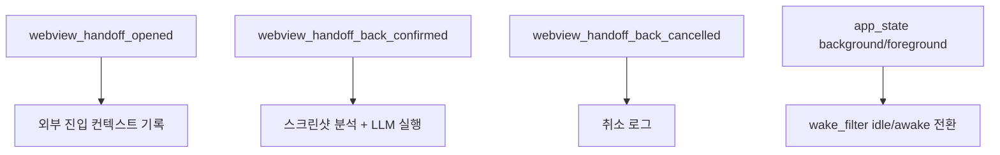
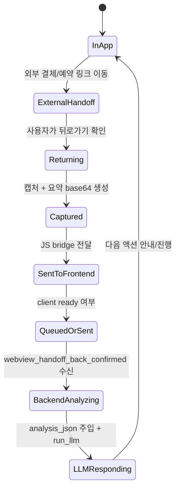
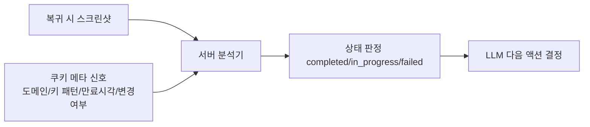

# 외부 사이트 복귀 후 스크린샷 분석 + LLM 액션 구현 분석

이 문서는 **외부 예약/결제 사이트로 이동했다가 앱으로 돌아왔을 때**,  
스크린샷을 기반으로 상태를 분석하고 LLM이 다음 액션을 수행하도록 만든 구현을
`Android 앱` + `Frontend` + `Backend` 관점에서 end-to-end로 정리한 분석 문서입니다.

---

## 1) 한눈에 보는 전체 아키텍처

```mermaid
flowchart LR
    A[Android WebViewActivity] --> B[HandoffWebViewActivity<br/>외부 URL 전용]
    B --> C[복귀 시 캡처<br/>full screenshot + tiny base64]
    C --> A
    A --> D["window.sendHandoffScreenshot(...)"]
    D --> E[voice-ui-kit Console<br/>global hook]
    E --> F["RTVI client.sendClientMessage<br/>webview_handoff_back_confirmed"]
    F --> G[pipecat mobile/voice_ai.py<br/>on_client_message]
    G --> H[_handoff_screenshots[session_id] 저장]
    H --> I[analyze_handoff_screenshot_for_session]
    I --> J[Vision JSON 분석 결과]
    J --> K[LLMMessagesAppendFrame run_llm=True]
    K --> L[최종 답변/다음 액션]
```

핵심 포인트:
- **Android는 복귀 시점 상태를 캡처**하고
- **Frontend는 브릿지/큐잉/RTVI 전송**을 담당하며
- **Backend는 즉시 Vision 분석 후 LLM 실행을 강제**합니다.

---

## 2) Android 구현 분석

### 2.0 시작 시나리오: "새 WebView + Back to AI 버튼" 기준 상세 플로우

요청하신 시작점(외부 사이트 진입 시 새로운 WebView를 열고 `Back to AI` 버튼이 보이는 흐름)부터
사용자 행동 중심으로 풀면 아래와 같습니다.

#### 화면 기준 타임라인



#### 실제 UI 구성

`HandoffWebViewActivity` 레이아웃에는 다음 3요소가 고정됩니다.
- 전체 화면 `WebView` (`handoffWebView`)
- 좌하단 `Button` (`btnBack`) 텍스트: **`Back to AI`**
- 캡처 중 오버레이 (`loadingOverlay`) + `"화면을 정리하고 있어요..."` 메시지

즉, 사용자는 외부 사이트를 보다가 언제든 **명시적으로 AI로 복귀**할 수 있습니다.

#### "Back to AI" 버튼 클릭 이후 내부 단계



#### 백 버튼(하드웨어/시스템) 동작도 동일 컨셉

- handoff 화면에서 디바이스 Back:
  - `webView.canGoBack()`면 외부 사이트 내 히스토리 뒤로
  - 더 이상 뒤로 갈 수 없으면 동일하게 복귀 확인 다이얼로그
- 결국 **AI 복귀 경로는 `captureAndFinish()` 단일 진입점**으로 수렴합니다.

### 2.1 외부 링크를 handoff로 분리

`CustomWebView`에서 out-bound `http(s)` 링크를 감지하면 `WebViewActivity.openExternalUrlViaHandoff()`로 위임합니다.

- OAuth 계열 URL은 handoff로 보내지 않고 기존 WebView에서 처리
- 일반 외부 링크는 `HandoffWebViewActivity`로 이동
- 이동 직전 `window.onHandoffOpened({url})` JS 호출 시도



### 2.2 복귀 시 캡처 전략

`HandoffWebViewActivity.captureAndFinish()`에서:
- `captureFullBitmap()`으로 전체 페이지 캡처
- 파일 URI(고해상도) + Base64 썸네일(엄격한 크기 제한) 동시 생성
- 결과를 `ActivityResult`로 `WebViewActivity`에 반환

Base64를 작게 유지하는 이유:
- 주석 그대로 **RTVI/WebRTC datachannel payload 안정성** 확보 목적
- `MAX_THUMBNAIL_JPEG_BYTES = 8000`로 보수적으로 제한

#### 스크린 캡처 데이터 생성 상세 (Android 내부)



실제로 만들어지는 값:
- `screenshot_uri`: 앱 캐시 파일에 대한 `FileProvider` URI 문자열 (원본 캡처 참조용)
- `screenshot_base64`: 분석/전송용 소형 썸네일(base64 문자열)
- `page_url`: handoff WebView 현재 URL
- `page_title`: handoff WebView 현재 title

### 2.4 ActivityResult → JS 브릿지 전달 데이터

`WebViewActivity.handleHandoffResultAfterReconnect()`에서 JS로 넘기는 객체(`jsData`)는 아래 형태입니다.

```json
{
  "handoff_id": "",
  "screenshot_base64": "<tiny-jpeg-base64>",
  "screenshot_uri": "content://com.lgcns.codeengine.fileprovider/.../handoff_1743500000000.jpg",
  "page_url": "https://payment.example.com/complete",
  "page_title": "결제 완료"
}
```

그리고 실제 호출 함수:
- 성공: `window.sendHandoffScreenshot(jsData)`
- 취소/실패: `window.cancelHandoffBack(jsData)`

### 2.3 복귀 후 프론트 전달 + 재연결 보장

`WebViewActivity.handleHandoffResultAfterReconnect()`:
1. `ensurePipecatConnected(timeout=10s)`로 연결 상태 확인/재시도
2. 성공/실패와 무관하게 JS 콜백 호출
   - 성공: `window.sendHandoffScreenshot(...)`
   - 취소: `window.cancelHandoffBack(...)`

즉, **연결 준비를 최대한 보장하고**, 미준비여도 이벤트 전달은 시도해 프론트 큐잉으로 넘기는 구조입니다.

---

## 3) Frontend 구현 분석 (small-webrtc-prebuilt + voice-ui-kit)

실제 handoff 글로벌 훅(`window.sendHandoffScreenshot`, `window.onHandoffOpened`)은
앱 엔트리(`small-webrtc-prebuilt`)가 아니라 `voice-ui-kit`의 `ConsoleTemplate`에 구현되어 있습니다.

### 3.1 Android ↔ Front 브릿지 포인트

`voice-ui-kit/package/src/templates/Console/index.tsx`에서:
- `window.onHandoffOpened(data)` → `webview_handoff_opened` 전송
- `window.sendHandoffScreenshot(data)` → `webview_handoff_back_confirmed` 전송
- `window.cancelHandoffBack(data)` → `webview_handoff_back_cancelled` 전송

클라이언트가 `ready`가 아니면 즉시 전송하지 않고 `__pendingNativeMessages` 큐에 넣고 주기적으로 flush합니다.

#### Frontend에서 서버로 보내는 실제 payload

`client.sendClientMessage(type, payload)` 기준:

```json
{
  "type": "webview_handoff_back_confirmed",
  "payload": {
    "handoff_id": "",
    "screenshot_base64": "<tiny-jpeg-base64>",
    "page_url": "https://payment.example.com/complete",
    "page_title": "결제 완료"
  }
}
```

참고:
- 현재 프론트 전송 payload에는 `screenshot_uri`는 포함하지 않고, `screenshot_base64` 중심으로 전송합니다.
- 연결 미준비 시에는 동일 payload가 큐에 쌓였다가 flush 시점에 전송됩니다.

### 3.2 UX 처리 (복귀 직후 사용자 체감)

`sendHandoffScreenshot()` 호출 시:
- 대화창에 `"외부 사이트에서 돌아왔어요."` user 메시지 강제 주입
- 상단 배너 `외부 사이트에서 돌아오셨군요! 잠시만 기다려주세요...` 표시
- 서버 응답(assistant 메시지/BotLlmStarted) 시점에 배너 자동 종료

즉, **분석 지연 시간 동안 사용자에게 진행 상태를 명확히 표시**합니다.

### 3.3 app_state 연동 (백그라운드/포그라운드)

Android의 `BaseWebViewActivity.sendAppStateToServer()`는 JS 훅(`sendAppStateMessage`)을 통해
`app_state` 메시지를 보냅니다.  
프론트는 이를 RTVI로 전달하고, 서버는 wake 상태를 제어합니다.

---

## 4) Backend 구현 분석 (pipecat/mobile)

핵심은 `mobile/voice_ai.py`의 `@rtvi.event_handler("on_client_message")`.

### 4.1 handoff_back_confirmed 처리 체인



### 4.2 분석 도구 스펙

`analyze_handoff_screenshot_for_session()`의 주요 설계:
- 세션별 in-memory 캐시 `_handoff_screenshots`
- Vision 입력 전 리사이즈/압축(`max_side`, `jpeg_quality`)으로 비용/속도 최적화
- JSON 스키마 강제 응답:
  - `status`: `completed | in_progress | abandoned | failed | unknown`
  - `confidence`, `evidence`, `extracted`, `user_message`
- 성공 시 캐시에서 해당 스크린샷 제거(pop)
- 실패/타임아웃 시도 사용자 친화 fallback JSON 반환

### 4.3 LLM 실행 정책 (중요)

`voice_ai.py`에서 복귀 이벤트 수신 시:
- 서버가 **직접 분석 도구를 먼저 실행**
- 분석 JSON을 user message로 컨텍스트에 주입
- `run_llm=True`로 **즉시 1회 실행**
- 프롬프트에 `"중간 안내만 말하고 멈추지 말라"` 규칙까지 포함

즉, “분석 따로, 응답 따로”가 아니라 **분석 결과를 근거로 바로 완결 응답**을 유도합니다.

---

## 5) 메시지 프로토콜 요약



대표 payload:
- `webview_handoff_back_confirmed`
  - `handoff_id`
  - `screenshot_base64` (축소 썸네일)
  - `page_url`, `page_title`
- `app_state`
  - `state: background | foreground`

### 5.1 Handoff 관련 메시지 스키마 (현재 기준)

```json
{
  "webview_handoff_opened": {
    "url": "https://external.example.com/checkout"
  },
  "webview_handoff_back_confirmed": {
    "handoff_id": "",
    "screenshot_base64": "<base64-jpeg-under-about-8KB>",
    "page_url": "https://external.example.com/complete",
    "page_title": "예약 완료"
  },
  "webview_handoff_back_cancelled": {
    "handoff_id": ""
  }
}
```

### 5.2 Backend 내부 저장/처리 데이터

`voice_ai.py` 수신 후:
- `_handoff_screenshots[session_pc_id] = screenshot_base64`
- `analyze_handoff_screenshot_for_session(session_pc_id)` 호출
- 반환 JSON을 LLM 컨텍스트에 주입

분석기 반환 예시:

```json
{
  "status": "completed",
  "confidence": 0.93,
  "evidence": ["'예약 완료' 문구 확인", "확정 번호 영역 확인"],
  "extracted": {
    "vendor": "Example Booking",
    "reservation_id": "AB12C3",
    "item_name": "디럭스 더블룸",
    "dates": "2026-04-10 ~ 2026-04-12",
    "total_price": "420000",
    "currency": "KRW",
    "payment_method_hint": "카드 결제 완료 배지"
  },
  "user_message": "예약이 완료된 것으로 보입니다."
}
```

---

## 6) 상태 전이 관점 (사용자 여정)



---

## 7) 구현 품질 평가 (강점/리스크)

### 강점
- 복귀 시점 캡처를 **OS Activity 레벨**에서 보장 (브라우저 앱 전환 대비 안정적)
- 프론트에 **ready 전 큐잉**이 있어 연결 타이밍 이슈를 완화
- 백엔드가 분석→LLM 실행을 직렬 강제해 사용자 체감 지연/혼선 최소화
- `InterruptionFrame`으로 직전 TTS를 끊고 handoff 응답 우선 처리

### 리스크/주의점
- `_handoff_screenshots`가 프로세스 메모리 기반이라 **멀티 프로세스/재시작**에 취약
- 썸네일 Base64만 전송하므로 작은 텍스트/세부 영수증 판독 정확도 한계 가능
- 외부 사이트가 고동적/캔버스 렌더링이면 캡처 타이밍에 따라 증거가 약해질 수 있음
- `session_pc_id` 매칭 실패 시 분석이 `unknown`으로 폴백

---

## 8) 향후 고도화: 쿠키 분석 기반 정밀 판단

현재는 복귀 시점의 스크린샷 중심으로 상태를 판정합니다.  
향후 `HandoffWebViewActivity`의 `CookieManager` 데이터를 함께 활용하면,
예약/결제 완료 여부를 더 정밀하게 판단할 수 있습니다.

### 8.1 왜 쿠키가 유의미한가

- 결제/예약 사이트는 완료 시점에 `order`, `booking`, `checkout`, `txn` 계열 세션/상태 쿠키를 갱신하는 경우가 많음
- 화면 텍스트가 빈약하거나(아이콘 중심 UI), 캡처 타이밍이 애매할 때도 **서버 상태 변화 신호**를 보강할 수 있음
- 스크린샷 단일 증거 대비 `completed / in_progress / failed` 분류 신뢰도 향상 가능

### 8.2 추천 결합 전략 (Vision + Cookie)



권장 포인트:
- 쿠키 **원문 전체**를 LLM에 그대로 전달하지 말고, 앱에서 먼저 요약/정규화
- LLM 입력은 `cookie_signal_summary` 형태(예: 도메인, 키워드 매칭, 직전 대비 변경 수)로 제한
- 최종 상태는 `vision evidence` + `cookie signals`를 함께 근거로 채택

### 8.2.1 제안 payload 스키마 (구현 초안)

아래처럼 `webview_handoff_back_confirmed`에 optional 필드로 확장하는 방식을 권장합니다.

```json
{
  "handoff_id": "",
  "screenshot_base64": "<tiny-jpeg-base64>",
  "page_url": "https://pay.example.com/complete",
  "page_title": "결제 완료",
  "cookie_signal_summary": {
    "captured_at": "2026-04-01T11:12:13+09:00",
    "domain": "pay.example.com",
    "cookie_count": 24,
    "changed_cookie_count": 5,
    "matched_keys": ["order", "checkout", "transaction"],
    "status_hints": ["order_complete_like", "payment_session_closed"],
    "sensitive_value_redacted": true
  }
}
```

설계 의도:
- `cookie_count` / `changed_cookie_count`: 상태 변화 강도 신호
- `matched_keys`: 완료/진행/실패 추정 키워드 근거
- `status_hints`: 앱 레벨에서 1차 추론한 힌트(LLM 보조 입력)
- `sensitive_value_redacted`: 민감값 비노출 보증 플래그

### 8.3 보안/컴플라이언스 주의

- 쿠키 값에는 세션 토큰 등 민감정보가 포함될 수 있으므로 **원문 전송 금지**
- 화이트리스트 기반 키 추출(예: `*order*`, `*booking*`, `*checkout*`) + 마스킹 필수
- 저장 시 TTL 짧게 운영하고, 세션 종료 시 즉시 삭제
- 외부 도메인 쿠키 취급은 법무/보안 정책 검토 필요

### 8.4 적용 우선순위 제안

1. Android: handoff 종료 시점 쿠키를 메타 신호로만 추출(값 마스킹/해시)
2. Frontend: 기존 handoff payload에 `cookie_signal_summary` optional 필드 추가
3. Backend: `analyze_handoff_screenshot_for_session` 결과 후처리에서 cookie 신호를 결합한 confidence 재보정
4. Prompt: "vision 단독 판단이 애매하면 cookie signal을 보조 근거로 사용" 규칙 추가

### 8.5 결합 판정 로직 예시 (운영 규칙 초안)

```text
if vision.status == "completed" and cookie.status_hints contains complete_like:
    final.status = "completed"
    confidence = min(1.0, vision.confidence + 0.05)
elif vision.status in ["unknown", "in_progress"] and cookie has strong complete signal:
    final.status = "completed"
    confidence = max(vision.confidence, 0.75)
elif vision.status == "completed" but cookie has failure-like signal:
    final.status = "in_progress"
    confidence = 0.55
else:
    final.status = vision.status
    confidence = vision.confidence
```

핵심은 쿠키가 비전 결과를 **무조건 대체**하는 것이 아니라,
애매한 케이스의 confidence를 보정하는 **보조 증거**로 동작하게 하는 것입니다.

---

## 9) 앱 인벤토리 기능과의 관계

이번 handoff 분석 플로우와 별도로, 현재 코드베이스에는 `app_inventory`(설치앱 스냅샷 업로드/조회)도 함께 구현되어 있습니다.

- handoff 복귀 분석의 **직접 입력**은 `screenshot_base64` + 페이지 메타데이터
- app inventory는 사용자 맥락(어떤 앱 생태인지) 보강에는 유용하지만,
  현재 handoff 이벤트 처리 경로에서 **직접 참조되지는 않음**

즉, 지금 구현은 “복귀 화면 기반 즉시 판단”에 초점이고, app inventory는 개인화 확장 여지에 가깝습니다.

---

## 10) 코드 추적 포인트

- Android
  - `mobile_pipecat_android/.../ui/CustomWebView.kt`
  - `mobile_pipecat_android/.../activity/WebViewActivity.kt`
  - `mobile_pipecat_android/.../activity/HandoffWebViewActivity.kt`
  - `mobile_pipecat_android/.../activity/BaseWebViewActivity.kt`
  - `mobile_pipecat_android/.../util/extension/ScreenshotExtensions.kt`
- Frontend
  - `voice-ui-kit/package/src/templates/Console/index.tsx`
  - `small-webrtc-prebuilt/client/src/index.tsx`
  - `small-webrtc-prebuilt/client/src/auth/store.ts`
- Backend
  - `pipecat/mobile/voice_ai.py`
  - `pipecat/mobile/tools/langgraph_adapters.py`
  - `pipecat/mobile/langgraph_prompt.py`
  - `pipecat/mobile/starting_prompt.py`

---

## 11) 결론

현재 구현은 요청하신 목표(외부 사이트 복귀 시 상태 분석 후 LLM 다음 액션 수행)를
**실사용 가능한 형태로 end-to-end 연결**해 두었습니다.

특히 강한 부분은:
1. Android에서 캡처/복귀 이벤트를 구조화해 전달하고
2. Frontend에서 연결 상태를 감안해 안전하게 중계하며
3. Backend에서 분석 결과를 즉시 LLM 실행으로 연결한다는 점입니다.

다음 고도화 우선순위는 `in-memory screenshot cache의 내구성`과 `고해상도/세부정보 판독 개선`입니다.
