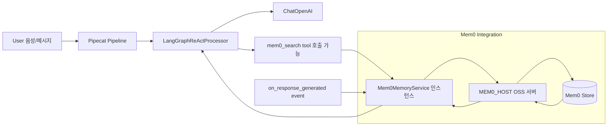
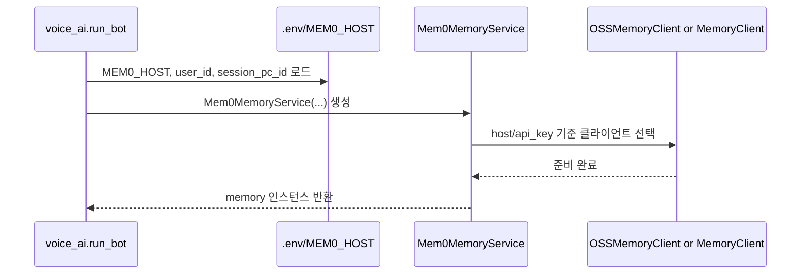
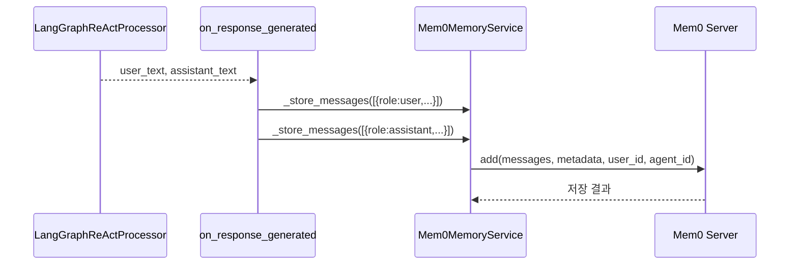
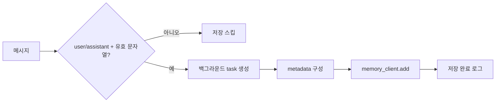
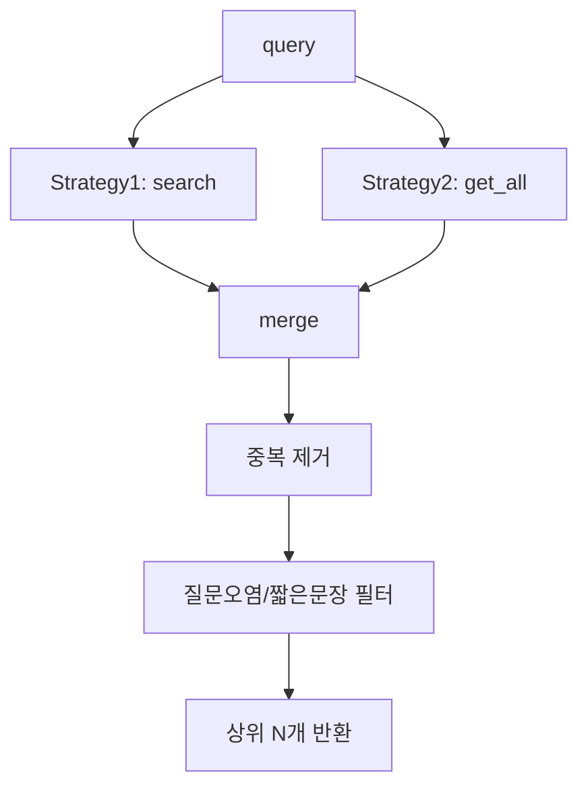
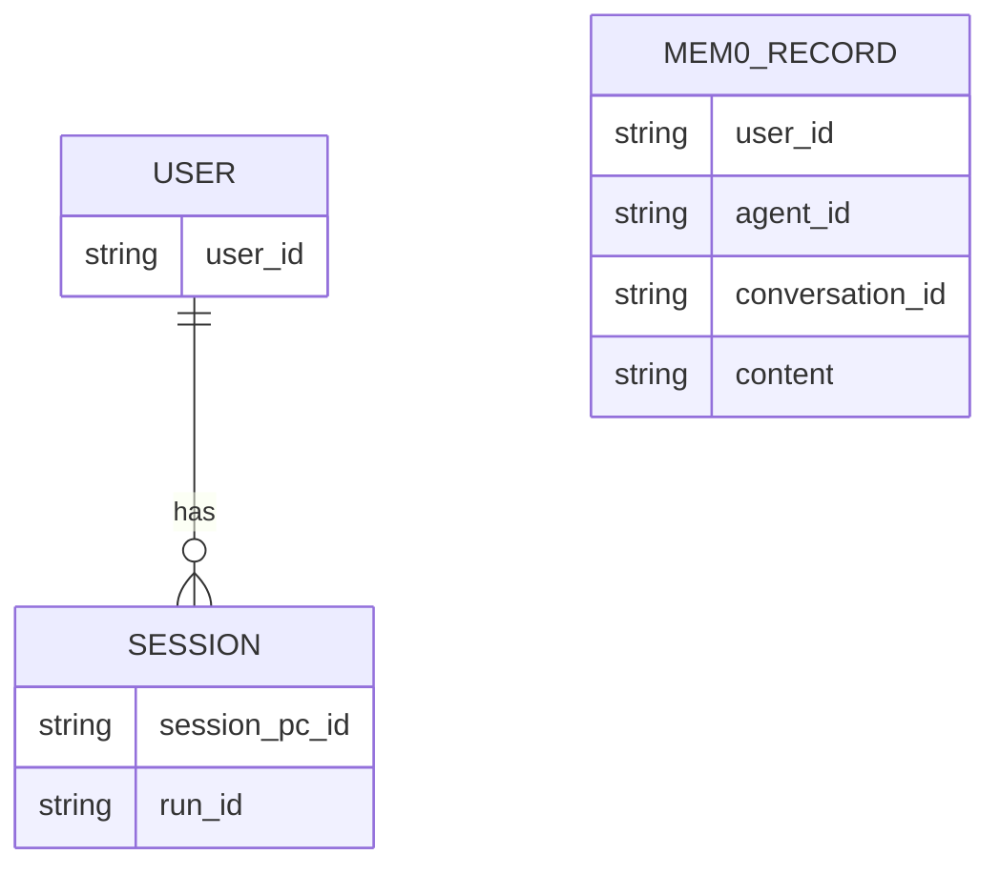
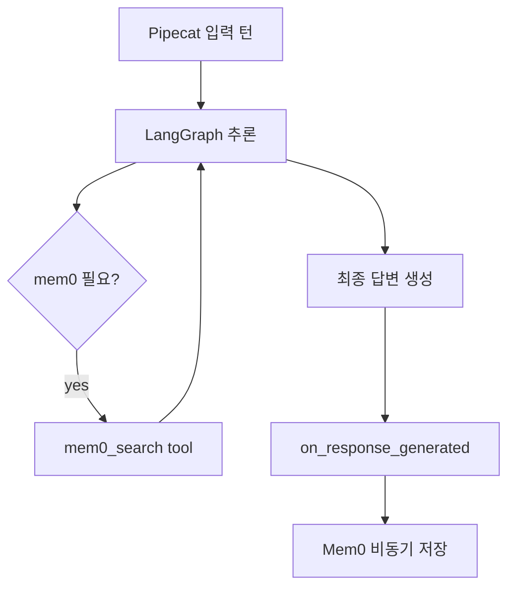
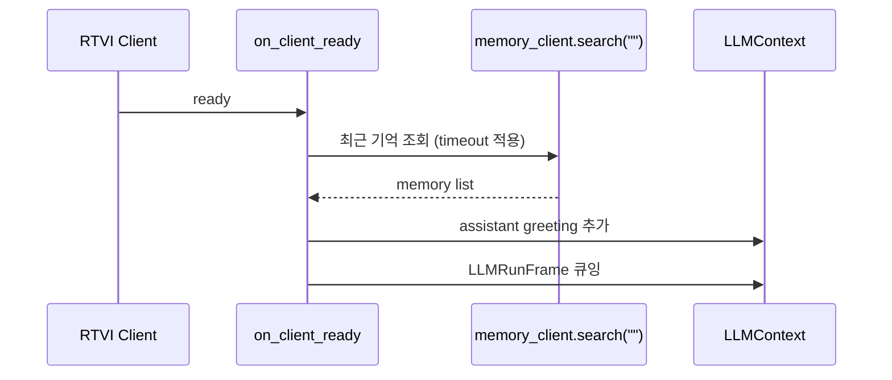

# Mem0-Pipecat 연동 상세 가이드

이 문서는 현재 구현(`mobile/voice_ai.py`, `mobile/tools/langgraph_adapters.py`, `src/pipecat/services/mem0/memory.py`) 기준으로,  
**Mem0가 Pipecat 파이프라인에 어떻게 붙어 동작하는지**를 상세히 설명합니다.

---

## 1) 한눈에 보는 전체 구조



- Pipecat는 실시간 파이프라인 오케스트레이션을 담당합니다.
- Mem0는 독립 메모리 계층으로 붙고, 현재 구현에서는 **LangGraph + 이벤트 훅**을 통해 활용됩니다.
- 즉, “자동 프레임 삽입형”보다 “필요 시 검색 + 응답 후 저장”에 초점을 둔 통합 방식입니다.

---

## 2) 실제 코드에서의 연동 포인트

### A. 초기화 (`voice_ai.py`)

`run_bot()` 내부에서 `Mem0MemoryService`를 생성합니다.

- `host=MEM0_HOST` (기본 `http://localhost:8888`)
- `user_id`, `agent_id="voice-ai"`, `run_id=session_pc_id`
- `api_version="v2"`, `search_limit=5`, `search_threshold=0.35`
- `add_as_system_message=True`, `position=1`
- `is_meeting_mode_active_func` 주입 (회의 모드에서 메모리 연산 제어)



> 참고: `voice_ai.py` 주석에 명시되어 있듯, 현재 앱에서는 Mem0를 파이프라인 중간 프로세서로 직접 꽂기보다 검색/저장 유틸리티로 활용합니다.

---

### B. LangGraph Tool 연결 (`langgraph_adapters.py`)

`create_langgraph_local_tools(..., mem0_service=memory)`로 주입하면 `mem0_search` 툴이 조건부 추가됩니다.

- 에이전트가 필요할 때만 `mem0_search(query)` 호출
- 내부에서 `await mem0_service._retrieve_memories(query)` 수행
- 결과를 정리해 JSON(`query`, `count`, `memories`) 반환

```mermaid
flowchart TD
    A[ReAct 추론] --> B{과거 맥락 필요?}
    B -- 예 --> C[mem0_search 호출]
    C --> D[_retrieve_memories(query)]
    D --> E[유사도+최신성 병합]
    E --> F[중복/노이즈 필터]
    F --> G[JSON memories 반환]
    B -- 아니오 --> H[다른 tool 또는 직접 응답]
```

이 패턴 덕분에 “모든 턴마다 자동 메모리 검색”이 아니라, 필요 턴에서만 검색하게 되어 응답 지연을 줄일 수 있습니다.

---

### C. 응답 완료 후 저장 (`voice_ai.py` 이벤트 훅)

`LangGraphReActProcessor`에 `on_response_generated` 이벤트 핸들러를 등록해 저장합니다.

- `user_text`가 있으면 user 메시지 저장
- `assistant_text`가 있으면 assistant 메시지 저장
- 내부적으로 `memory._store_messages(...)` 호출



핵심은 **응답 생성이 끝난 뒤 비동기 저장**을 걸어 메인 음성 파이프라인 지연을 최소화한다는 점입니다.

---

## 3) Mem0MemoryService 내부 동작 (중요)

`src/pipecat/services/mem0/memory.py` 관점에서 핵심 로직은 아래와 같습니다.

### 3.1 저장: `_store_messages()`

- 백그라운드 태스크(`asyncio.create_task`)로 저장
- user/assistant role만 저장
- mem0 컨텍스트 마커(`<!-- mem0_context -->`) 메시지는 재저장 방지
- `metadata.platform = "pipecat"` + `conversation_id/session_id = run_id`
- `memory_client.add(...)`는 thread로 실행해 이벤트루프 블로킹 방지



---

### 3.2 검색: `_retrieve_memories(query)`

듀얼 전략으로 검색합니다.

1. **Semantic search**: `search(query, threshold, limit)`
2. **Recency fetch**: `get_all(limit=20)`로 최신 컨텍스트 확보

두 결과를 병합한 뒤 중복/질문 오염/너무 짧은 텍스트를 필터링합니다.



이 구조 덕분에 “관련도 높은 기억”과 “최근 대화 맥락”을 동시에 확보합니다.

---

### 3.3 컨텍스트 강화: `_enhance_context_with_memories()`

서비스 자체는 원래 Pipecat `FrameProcessor`로도 동작 가능하며, 이 경우:

- 최신 user query 기준으로 메모리 검색
- `add_as_system_message=True`일 때 지정 위치(`position`)에 system memory 삽입
- 이전 mem0 컨텍스트 마커 제거 후 재삽입하여 누적 오염 방지

현재 모바일 구현은 이 기능을 “자동 파이프라인 삽입”보다 “필요 호출형 툴 + 이벤트 저장” 중심으로 사용합니다.

---

## 4) 세션/아이덴티티 매핑 방식



- `user_id`: OAuth 사용자 식별자
- `agent_id`: `"voice-ai"` 고정
- `run_id`: `session_pc_id` 사용
- 결과적으로 Mem0에서 사용자/에이전트/세션 단위로 검색/저장이 가능해집니다.

---

## 5) Pipecat와의 결합 포인트 요약



- **추론 시점 결합**: `mem0_search` tool
- **응답 후 결합**: `on_response_generated` 저장 훅
- **모드 제어 결합**: meeting mode 활성화 여부에 따라 검색/저장 스킵 가능

---

## 6) 장애/성능 대응 설계

### 6.1 장애 허용 (non-fatal)

- Mem0 초기화 실패 시 `memory=None`으로 계속 실행
- `mem0_search` 실패 시 에러 JSON 반환하고 대화는 지속
- 저장 실패/타임아웃도 파이프라인 전체를 멈추지 않음

### 6.2 성능 대응

- 저장은 백그라운드 처리
- `memory_client` 동기 I/O는 `asyncio.to_thread`로 분리
- 초기 personalized greeting 조회도 timeout으로 감싸 전체 지연 제어


---

## 7) 초기 인사(personalized greeting)까지의 흐름

클라이언트 준비 시(`on_client_ready`) Mem0에서 최근 기억을 조회해 개인화 인사를 생성합니다.



첫 턴부터 개인화된 톤으로 시작할 수 있게 하는 장치입니다.

---

## 8) 실무 관점 체크리스트

- `MEM0_HOST` 접근 가능 여부 확인
- `user_id`/`run_id(session_pc_id)` 전달 경로 확인
- meeting mode 시 메모리 정책(검색/저장 스킵) 의도대로인지 점검
- `mem0_search` tool description이 프롬프트 정책과 일치하는지 확인
- 개인정보/민감정보 저장 정책 별도 검토

---

## 9) 결론

현재 구조에서 Mem0는 Pipecat에 다음 방식으로 통합됩니다.

1. **런타임 초기화**: 세션/사용자 컨텍스트를 가진 `Mem0MemoryService` 생성  
2. **추론 중 검색**: LangGraph tool(`mem0_search`)로 필요 시 회상  
3. **응답 후 저장**: `on_response_generated` 훅에서 비동기 영속화  
4. **실시간 안정성 유지**: 오류/타임아웃을 non-fatal로 처리

즉, “실시간성(Pipecat)”과 “장기기억(Mem0)”을 충돌 없이 결합하기 위해,  
**선택적 검색 + 비동기 저장 + 예외 격리** 패턴으로 설계된 통합입니다.

