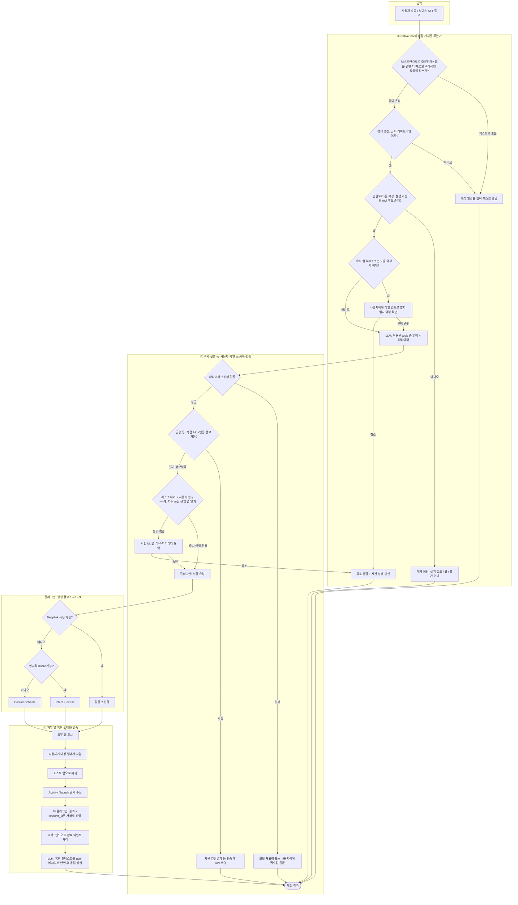
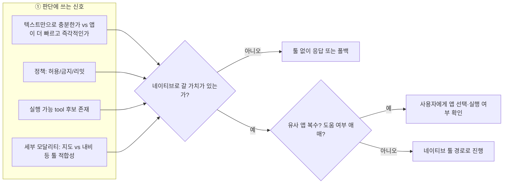
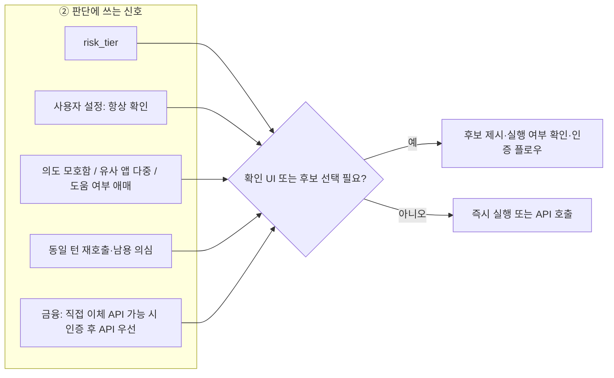
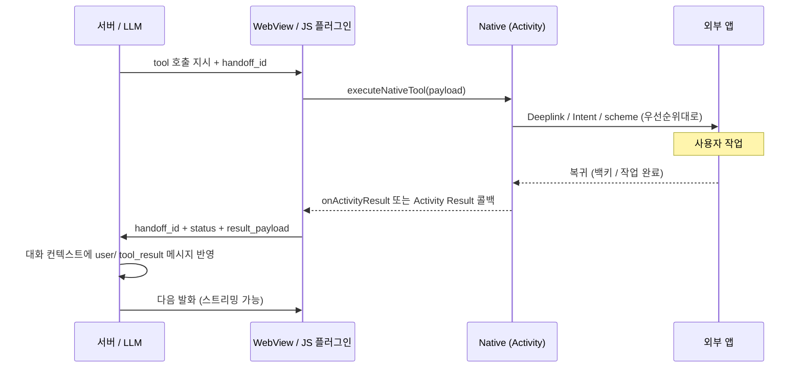

# 네이티브 앱 툴과 LLM 연동 설계 — 의사결정·정보 제공 방식

앱 사용 빈도 기반 인벤토리 전달·서버 카테고리 분류까지의 “전단계”가 갖춰진 뒤, 남은 핵심은 **LLM이 그 정보를 어떻게 안전하고 일관되게 활용할 것인가**이다. 이 문서는 MCP 스타일의 네이티브 툴 호출 흐름(선택 → 플러그인/API → 딥링크/Intent/scheme)을 전제로, **호출 여부·사용자 확인·판단 근거·프롬프트/컨텍스트 설계**에 대한 정리된 의견을 담는다.

---

## 0. 플러그인 실행 방식 우선순위 (정확도·안전성 순)

대상 앱이 제공하는 API 형식에 따라, **플러그인 내부**에서는 아래 순서로 시도하는 것을 권장한다. 앞쪽이 계약이 명확하고 파라미터 검증·오동작 가능성이 상대적으로 낮다는 전제다.

| 순위 | 방식 | 비고 |
|------|------|------|
| 1 | **Deeplink (App Links / verified deep link)** | URI 스키마·호스트·경로가 문서화된 경우가 많고, OS·앱이 의도한 화면으로 라우팅하기 쉬움 |
| 2 | **Android Intent (명시적/암시적, extras)** | 패키지·액션·카테고리·extras로 의미가 분리되어 있으면 디버깅·권한 처리에 유리 |
| 3 | **Custom scheme (`myapp://...`)** | 구현은 빠르지만 앱·버전별 편차·충돌 가능성이 상대적으로 큼 — **마지막 수단** |

툴 메타데이터에는 “이 툴이 지원하는 실행 경로”를 **우선순위와 함께** 적어 두고, 런타임에 1→2→3 순으로 **가용성 검사 후 첫 성공 경로**를 쓰는 패턴이 일반적이다.

---

## 0.1 LLM이 판단하기 위해 필요한 사전 정보 (Prerequisites)

아래는 **서버가 모델에 넣기 전에 갖추어야 할 정보**와, **클라이언트·정책 엔진이 별도로 유지하는 정보**를 나눈 체크리스트다. 전부를 LLM 프롬프트에 넣을 필요는 없고, **툴 선택에 필요한 최소 집합**과 **실행 게이트용 집합**을 구분하면 된다.

### A. 툴 계약 (서버 DB / tools 스키마)

- [ ] **현재 세션에서 허용된 `tool_id` 목록** (미설치·지역 제한·A/B로 제외된 툴은 제외).
- [ ] 각 툴의 **이름·설명(언제 쓰는지)·금지/주의 문구**.
- [ ] **파라미터 스키마** (JSON Schema): 필수 필드, 타입, enum, 기본값.
- [ ] **실행 메타**: 딥링크 템플릿 / Intent 액션·extras 키 / scheme — **우선순위 1→2→3** 필드.
- [ ] **리스크·확인 정책**: `risk_tier`, `requires_user_confirmation_default` 등.
- [ ] (금융·송금 등) **직접 API 가능 여부·인증 경로**: 앱 딥링크만 열지, **지문·간편결제 등 인증 후 서버/API 호출**로 끝낼 수 있는지 구분할 메타데이터.

### B. 사용자·단말 컨텍스트 (인벤토리 파이프라인 산출물)

- [ ] **설치 앱 목록** (가능하면 패키지명·표시 이름·카테고리).
- [ ] **사용 빈도 또는 최근 사용** (개인화 힌트용; 강제 매핑용 아님).
- [ ] **툴 ↔ 설치 앱 매칭 결과** (“이 `tool_id`는 지금 이 단말에서 실행 가능/불가”).

### C. 대화·세션 상태

- [ ] **최근 사용자 발화·요약** (목표가 행동인지 정보 질의인지).
- [ ] **동일 세션에서 이미 연 앱·미완료 핸드오프** (중복 실행·재진입 방지).
- [ ] (선택) **사용자 설정**: “앱 열기 전 항상 확인” 등.

### D. 비 LLM 레이어 (프롬프트 밖에서 유지해도 되는 것)

- [ ] **정책 룰**: 금지 카테고리, 시간대, 기업 정책 등.
- [ ] **레이트 리밋**: 턴당 네이티브 툴 호출 횟수.
- [ ] **스키마 검증 결과**: 모델 출력 후 필수 필드 누락 시 재요청.

### E. 앱 복귀 후 연속 대화 (핸드오프 결과)

- [ ] **호출 상관 ID (`handoff_id` / `request_id`)**: 요청·실행·복귀를 한 줄로 잇기.
- [ ] **네이티브에서 돌아온 결과 페이로드** (성공/취소/타임아웃, 앱이 돌려준 문자열·코드 등).
- [ ] **클라이언트 메타**: 복귀 시각, 사용자가 앱에서 조기 이탈했는지 등.

이 중 A+B+C(+E가 열릴 때)가 LLM의 “다음 말·다음 툴”에 직접 쓰이고, D는 주로 **게이트·검증**에 쓴다.

---

## 0.2 플로차트 (Flowchart)

### 0.2.1 메인: 사용자 발화부터 네이티브 실행·복귀까지

### 0.2.2 판단 기준만 추출: ① 체감 가치·유사 앱·애매함

**한 줄 요약**: “**앱을 열면 사용자에게 더 빠르고 즉각적인 도움**이 되는 경우”에 네이티브 툴을 쓴다. **유사 앱이 여러 개이거나** 도움이 될지 **애매하면** 먼저 사용자에게 묻는다. 그 위에 정책·인벤토리·**의도에 맞는 툴 종류(예: 지도 vs 내비)** 가 맞물린다.

### 0.2.3 판단 기준만 추출: ② 바로 실행 vs 물어본 뒤 실행 · API+인증

**한 줄 요약**: **정책·리스크·모호함·유사 앱 다중·사용자 설정**이 “묻기”를 결정한다. **송금 등**은 계좌 정보가 없으면 자주 쓰는 은행 앱 열기 등으로 보조할 수 있고, **직접 API가 있으면** 지문·간편결제 등 **인증 후 API**를 우선하는 편이 일관되다. LLM은 확인 문구·후보 나열을 보조한다.

### 0.2.4 앱 복귀 후 서버 연동 (launch 결과 → 대화 지속)

호스트 앱은 외부 앱을 연 뒤 **복귀 시점**에만 서버가 알 수 있는 정보를 보낼 수 있다. Android에서는 `startActivityForResult` / **Activity Result API** 등으로 `Activity` 결과를 받고, 그 값을 **JS 브릿지**로 웹 레이어에 넘긴 뒤 **HTTP/WebSocket**으로 서버에 올리는 패턴이 일반적이다.

**설계 포인트**

- **`handoff_id`**: 같은 “열기 요청”과 복귀 이벤트를 묶는다. 없으면 멀티 턴·재시도에서 꼬인다.
- **결과 페이로드**: 앱이 아무것도 안 돌려주는 경우가 많다. 그때는 `completed` / `cancelled` / `timeout` 같은 **상태만** 보내고, LLM은 “돌아왔으니 다음에 무엇을 할지”를 묻는 식으로 이어갈 수 있다.
- **생명주기**: 외부 앱이 길게 떠 있는 동안 **세션 타임아웃** 정책을 서버·클라이언트가 합의해야 한다.

---

## 1. 목표와 제약

### 1.1 목표

- 사용자 질의 처리 시 **적절한 네이티브 앱을 능동적으로** 열거나 딥링크할 수 있게 한다.
- 툴은 **이름·목적·파라미터 스키마**가 명확한 MCP 유사 계약을 따른다.
- 클라이언트는 이미 설계한 **JavaScript 플러그인 + 사전 API**로 실행을 위임한다.

### 1.2 반드시 다루어야 할 제약

- **플랫폼/OS·앱 버전**에 따라 scheme·Intent 동작이 다르다.
- **사용자 동의·프라이버시**: “어떤 앱을 켤지”는 제품 정책과 법적 고지 범위 안에서만 자동화할 수 있다.
- **환각**: LLM이 존재하지 않는 툴이나 파라미터를 만들어내면 클라이언트가 실패한다. 계약(스키마)과 검증이 필요하다.

---

## 2. 전체 흐름과 역할 분담

제시하신 실행 순서는 다음과 같이 정리할 수 있다.

| 단계 | 주체 | 내용 |
|------|------|------|
| 1 | LLM + 오케스트레이션 | 네이티브 툴 선택, 파라미터 채움 |
| 2 | 클라이언트(웹/앱) | JS 플러그인이 노출한 API로 호출 수신 |
| 3 | 네이티브 레이어 | **딥링크 → Intent → scheme** 순으로 시도하여 앱 실행·딥링크 |

**핵심**: “LLM이 직접 앱을 연다”가 아니라, **구조화된 툴 호출**이 클라이언트·OS 정책을 거쳐 실행된다. 따라서 서버 쪽 설계는 **툴 정의·정책·검증**에 무게를 두는 것이 맞다.

---

## 3. 툴 메타데이터(DB)에 담아야 할 것

검색·큐레이션으로 미리 DB에 넣는다는 방향에 동의한다. 최소한 다음을 권장한다.

### 3.1 식별·계약

- **tool_id**: 안정적인 ID (예: `open_app_kakaomap_route`).
- **display_name**: LLM/사용자에게 보여줄 짧은 이름.
- **description (for model)**: 모델이 “언제 쓰는지” 판단하는 본문. **사용자에게 그대로 노출하지 않을 수 있음**을 전제로 써도 된다.
- **modality / role 힌트 (선택)**: 같은 지도·길찾기 계열이라도 **지도(탐색·시각화)** vs **내비(차량·턴바이턴)** vs **뱅킹(송금 화면 진입)** 등 구분 — LLM이 “경복궁까지 차로” 같은 발화에 맞는 툴을 고르는 데 도움이 된다.
- **parameter_schema**: JSON Schema 등. 필수/선택, 타입, enum, 기본값.
- **execution_paths (우선순위)**: `deeplink` → `intent` → `scheme` — DB에 각각 템플릿·extras 정의를 두고 플러그인이 1→2→3으로 시도.

### 3.2 앱·패키지 매핑

- **package_name / bundle_id** (해당 시).
- **inventory 매칭 키**: 사용자 폰 인벤토리의 앱 항목과 join할 수 있는 키 (패키지명, 정규화된 앱 이름 등).

### 3.3 정책·UX 메타

- **risk_tier**: `low` / `medium` / `high` (금융·설정·결제 등).
- **requires_user_confirmation_default**: 기본적으로 사용자 확인이 필요한지.
- **allowed_when_user_preference**: 사용자 설정(항상 물어보기 / 신뢰 앱은 자동 등)과 연동할 수 있는 태그.

### 3.4 품질·운영

- **source**: 수동 큐레이션 / 스크래핑 / 파트너 제공.
- **last_verified**, **deprecated**.

이렇게 해 두면 LLM 쪽은 “프롬프트에 긴 앱 목록을 붙이는 것”이 아니라, **선별된 툴 정의 + 사용자 컨텍스트**를 조합하기 쉬워진다.

---

## 4. 질문별 정리 — 내 의견

### 4.1 LLM이 네이티브 툴을 호출할지 말지

**원칙**: 호출은 “가능하면”이 아니라, **앱을 열면 사용자에게 더 빠르고 즉각적인 도움을 줄 수 있는 요청**에 한정하는 것이 좋다. “글로만 답할 수 없어서”가 아니라, **체감 가치(속도·시각·정확도)** 기준이다.

**예시 (모달리티·툴 종류)**

- **“경복궁까지 가는 방법”** — 긴 글로 설명하기보다 **지도 앱**에서 경로·지형을 시각적으로 보여 주는 편이 사용자에게 훨씬 도움이 될 수 있다.
- **“경복궁까지 차로 가는 길 안내해줘(찾아줘)”** — 일반 지도보다 **내비게이션 앱**을 바로 여는 것이 의도에 더 맞는 경우가 많다. 툴 메타데이터에 **용도 구분(지도 vs 내비)** 을 두면 LLM·라우터가 고르기 쉽다.

**금융·송금 (앱 열기 vs API)**

- **“○○한테 만 원 보내줘”**처럼 **상대 계좌·내 계좌 정보를 대화만으로 확정할 수 없을 때**, 자동 이체까지 대신 할 수 없다면 **자주 사용하는 은행 앱**을 열어 사용자가 이어서 처리하도록 돕는 경로가 있다 (인벤토리 빈도·카테고리와 연동).
- 반면 **직접 이체가 가능한 파트너 API**가 있고, **지문·간편결제 등 인증** 후 서버가 안전하게 호출할 수 있다면, **앱만 여는 것보다 “인증 → API”** 쪽을 우선하는 편이 일관되다. (이때는 네이티브 “앱 실행” 툴과 별도의 **보안 API 툴**을 구분하는 것이 설계상 명확하다.)

권장 접근:

1. **명시적 툴 호출 모드**  
   채팅/보이스 파이프라인에서 `function calling` / tool-use API를 쓰고, **시스템 지시**로 다음을 고정한다.  
   - **앱을 열면 사용자에게 더 빠르고 즉각적인 도움이 되는 경우**에 네이티브 실행 툴을 쓴다.  
   - 텍스트·음성만으로도 충분하고 앱이 체감 이득이 작으면 툴을 쓰지 않는다.

2. **계층화된 의사결정 (선택)**  
   - 먼저 **내부 정책/룰**로 필터.  
   - 그다음 LLM이 **의도에 맞는 툴 종류(지도/내비/메신저 등)** 를 고른다.

3. **인벤토리와의 결합**  
   툴 호출 직전에 **해당 앱이 설치되어 있는지**를 체크한다. 없으면 스토어 링크·웹·대체 안내.

**요약**: “호출 여부”는 **체감 가치** + **사용자 의도** + **툴 description·모달리티** + **정책/인벤토리**의 교집합으로 결정하고, LLM은 그 교집합 안에서만 선택하게 만드는 편이 안전하다.

---

### 4.2 사용자에게 어떤 앱을 켤지 물어볼지 vs 바로 실행할지

이건 **제품 신뢰도와 리스크** 문제이며, LLM에게만 맡기기보다 **정책 테이블 + 사용자 설정**이 우선이다. 아래는 사용자 의견을 반영한 권장이다.

| 상황 | 동작 |
|------|------|
| 저위험·의도가 명확 (예: “유튜브에서 ○○ 검색해줘”) | 기본: 확인 없이 실행 가능 — 단, **설정에서 끌 수 있음** |
| **유사한 앱이 여러 개 설치** (같은 카테고리·비슷한 툴 후보) | **어떤 앱으로 할지 사용자에게 물어본 뒤** 실행 |
| **앱을 실행하는 것이 도움이 될지 애매** | **실행 여부 또는 앱 선택**을 사용자에게 확인 |
| 중위험 (결제·민감 데이터·시스템 설정 인접) | 항상 확인 또는 생체/패스워드 이후 |
| 모호한 발화 (“뭐 좋은 앱 없어?”) | 앱 실행 전 **후보 제시 + 선택** |
| 사용자가 과거에 “항상 물어보기”로 둔 경우 | 정책 우선 |

LLM의 역할은 **“한 문장으로 왜 이 앱을 여는지”**를 요약해 확인 카드에 넣는 정도로 두고, **실행/취소의 최종 게이트**는 클라이언트/OS가 잡는 구조가 유지보수에 유리하다.

---

### 4.3 “호출이 필요한지” 판단 근거를 무엇으로 할지

근거는 **한 가지로 고정하지 말고** 레이어로 나누는 것을 권장한다.

1. **체감 가치 (텍스트 vs 앱)**  
   - 같은 “길 찾기”라도 **개념 설명**이 목적인지, **즉시 길 안내 화면**이 목적인지에 따라 앱 이득이 달라진다.

2. **세부 모달리티·툴 종류**  
   - 지도(탐색·POI) vs 내비(차량·턴바이턴) 등 **툴 메타데이터의 역할 구분**이 판단에 필요하다.

3. **툴 메타데이터의 description + 예시**  
   DB에 “이 툴이 해결하는 사용자 목표”를 짧은 예시와 함께 넣는다.

4. **인벤토리·카테고리·빈도**  
   “자주 쓰는 내비/은행 앱”은 **개인화 힌트**로 쓰되, **강제 단일 선택**은 피하고 **유사 앱이 여러 개면 사용자 선택**으로 넘긴다.

5. **세션 컨텍스트**  
   직전에 이미 같은 앱을 열었는지, 사용자가 특정 앱 이름을 말했는지.

6. **금융: API 가능 여부**  
   이체 API·인증 경로가 있으면 **앱 실행보다 API 우선**을 규칙으로 둘 수 있다.

7. **안전 규칙 (비 LLM)**  
   특정 키워드·카테고리는 LLM 출력 전에 정책 엔진이 검토.

**요약**: 판단 근거는 “LLM의 단일 chain-of-thought”에만 의존하지 말고, **체감 가치 + 모달리티 + 메타데이터 + 인벤토리 + (금융 시) API 가능성 + 정책**을 합성한 결과로 보는 편이 재현 가능하다.

---

### 4.4 동적 system prompt vs 다른 방식

여기서 선택지는 크게 네 가지 축으로 볼 수 있다.

#### A. 동적 system prompt (또는 developer 메시지)에 툴 요약 붙이기

- **장점**: 구현 단순, 모델이 “지금 쓸 수 있는 툴”을 바로 본다.
- **단점**: 토큰 증가, 긴 목록은 노이즈·누락, 버전 관리 어려움.

**적합**: 툴 수가 적거나, 세션당 **상위 N개만** 넣을 때.

#### B. RAG / 툴 검색 단계

- 사용자 질의 + 인벤토리 요약으로 **관련 툴 설명만** 검색해 컨텍스트에 넣는다.
- **장점**: 스케일 가능, 글로벌 툴 DB와 잘 맞음.
- **단점**: 검색 품질·지연, 인프라.

**적합**: 툴·앱 수가 많아질 때 필수에 가깝다.

#### C. 구조화된 tool 정의만 API로 (OpenAI/Anthropic 스타일 tools 파라미터)

- 모델 API의 **`tools`** 필드에 JSON Schema를 넣고, **툴 목록·파라미터 필드 정의를 프롬프트 본문에 길게 나열하지는 않는다**. 다만 **system(또는 developer) 프롬프트를 비우는 것은 아니다** — 네이티브 툴의 **호출 조건·사용 원칙·금지 사항** 등 **행동 규칙 전반**은 system에 두는 것이 좋다 (아래 §C.2).
- **장점**: 계약이 명확, 파싱·검증 파이프라인과 자연스럽게 연결.
- **단점**: 제공자별 포맷 차이.

**적합**: “MCP tool처럼” 가려는 현재 방향과 **가장 잘 맞는다**.

앱 카테고리마다 **2~3개 정도만** `tool`로 등록해 쓰는 전제라면, 긴 프롬프트나 RAG 없이 **C만으로도** 충분히 운영 가능하다. 아래는 그때의 **구현 절차**를 정리한 것이다.

#### C.1 구현 상세 — API `tools` + system(행동 규칙)

**의미**

- 툴 목록·**파라미터 스키마**는 **프롬프트 본문에 복붙하지 않고**, 채팅(또는 호환) API의 **`tools` / `tool_choice`**(벤더별 동등 필드)로 전달한다.
- 모델은 **이번 요청에 실린 `tools` 배열 안에서만** 함수·tool 호출을 할 수 있다.
- **파라미터 이름·타입·필수 여부 등 계약은 JSON Schema**에 두되, **“언제·어떻게 툴을 쓸지”에 대한 서술은 system에 둔다** — C 방식이라고 해서 system을 생략하거나 최소만 두는 것이 아니라, **네이티브 툴 관련 호출 조건·사용 방법·금지·확인 흐름**을 system에서 일관되게 안내하는 것이 좋다 (§C.2).

**데이터 모델 (서버·DB)**

카테고리당 소수이므로 테이블·문서 구조를 단순히 가져가면 된다. 레코드당 권장 필드:

| 필드 | 역할 |
|------|------|
| `tool_name` | API에 넣는 이름. 영문·스네이크·안정적 식별자 (예: `open_navigation_route`) |
| `description` | 모델용. **언제 호출할지** + 금지·주의 한 줄 |
| `parameters` | **JSON Schema** (`type`, `properties`, `required`, `enum` 등) |
| `category_id` | 지도·내비·뱅킹 등 |
| `package_candidates` | 인벤토리와 매칭할 패키지명 후보 (선택) |
| `execution` | 딥링크 템플릿·Intent·scheme 등 **플러그인이 쓰는 비모델 메타** |

**중요:** LLM 요청에 실리는 것은 보통 **`name` + `description` + `parameters`만**이고, `execution`은 서버가 **`tool_name`으로 조회**해 실행 단계에서만 붙인다. 모델이 실행 세부를 알 필요는 없다.

**요청 한 번을 만드는 절차**

1. **세션에 노출할 카테고리 결정** — 이번 턴과 관련 있을 법한 카테고리만 넣거나, 보수적으로 **사용자 인벤토리 카테고리와 교집합**만 노출.
2. **카테고리별 2~3개 툴 레코드 로드** → `tools[]` 후보 생성.
3. **인벤토리 필터** — `package_candidates`와 설치 목록이 맞지 않으면 해당 툴을 **`tools`에서 제거**해 “없는 앱 열기” 호출을 방지.
4. **(선택)** 유사 앱이 둘 이상이면 같은 역할 툴을 중복 등록하지 말고, **한 툴에 `app_choice` enum**을 두거나 **사용자 선택 UI를 먼저** 두는 흐름으로 정리 (본 문서 §4.2와 정합).
5. **API 호출** — `messages`: **§C.2에 해당하는 system** + (선택) `tool_environment`용 블록 + 대화 / `tools`: 위 배열만 / `tool_choice`: 보통 `auto`.

**벤더별 포맷 (개념)**

- **OpenAI 스타일**: `tools[]`에 `type: function`, `function: { name, description, parameters }` 형태.
- **Anthropic 스타일**: `tools[]`에 `name`, `description`, `input_schema`(JSON Schema). 흐름은 동일하고 필드 이름만 맞추면 된다.

**서버 쪽 툴 실행 루프**

1. **1차 completion** — `tools` 포함 호출.
2. 응답이 **일반 텍스트만**이면 그대로 사용자에게 반환.
3. **`tool_calls` / `tool_use`가 있으면** 각각에 대해: `arguments` JSON 파싱 → **JSON Schema 검증** → DB에서 `tool_name` → `execution` 조회 → **정책 게이트**(리스크·확인 UI) → 통과 시 클라이언트로 실행 명령(WebSocket/HTTP 이벤트 등).
4. 실행 결과를 대화에 반영(OpenAI: `role: tool` + `tool_call_id` / Anthropic: `tool_result` 등)한 뒤 **2차 completion**으로 자연어 응답 생성.
5. **`max_tool_rounds`**(예: 2~3)로 연속 호출 상한을 둔다.

**클라이언트 계약 (최소)**

- 서버 → 클라이언트: `call_id` / `handoff_id`, `tool_name`, 스키마 검증을 통과한 **정규화 payload**.
- 클라이언트: JS 플러그인 → 네이티브 실행; 복귀 시 §0.2.4대로 서버에 결과 전달.

**카테고리당 2~3개일 때 설계 팁**

- 툴 이름은 **행동·역할** 중심으로 겹치지 않게: 예) 지도로 장소 보기 vs 차량 내비는 **툴을 분리**하면 모델이 §4.1의 지도/내비 구분을 반영하기 쉽다.
- 파라미터는 **한 가지 표현으로 통일**(주소 문자열만 vs 위경도 등).

**Pipecat 연결 (개략)**

- 사용 중인 **LLM 서비스**에서 `tools` 배열을 넘기고, **tool_calls를 처리하는 프로세서/프레임**이 있으면 그 경로로 위 루프를 구현한다. 구체 클래스는 OpenAI·Anthropic·Realtime 등 선택한 어댑터에 따른다.

#### C.2 System prompt에 두는 내용 (C 방식과 함께 쓸 것)

C 방식은 **스키마를 `tools`로 분리**하는 것이지, **system을 비우라는 뜻이 아니다**. 아래는 **네이티브 툴을 쓸 때** system(또는 developer)에 포함하면 좋은 주제이다. 제품 톤에 맞게 문장으로 정리하면 된다.

| 주제 | 예시로 담을 수 있는 내용 |
|------|-------------------------|
| **역할** | 음성/채팅 어시스턴트로서의 기본 태도 |
| **호출 조건** | §4.1과 맞게 — “앱을 열면 사용자에게 더 빠르고 즉각적인 도움이 될 때만” 네이티브 실행 툴을 고려한다. 텍스트만으로 충분하면 툴을 쓰지 않는다. |
| **호출 보류·금지** | 유사 앱이 여러 개이거나 도움이 애매하면 **먼저 사용자에게 확인**한다. 남용·연속 호출 제한(`max_tool_rounds`)과 맞춘다. |
| **사용 방법 (개념)** | 각 툴은 `tools`에 스키마로 정의되어 있음을 전제로, **필수 인자를 비우지 말 것**, 값이 불확실하면 사용자에게 물어본 뒤 호출 등 **운영 규칙**을 적는다. (필드별 타입은 스키마가 단일 출처.) |
| **모달리티** | 지도 vs 내비 등 **의도에 맞는 툴 종류**를 고르는 기준을 한 줄이라도 넣으면 §4.1·DB `modality` 힌트와 합치된다. |
| **실행 전·후 UX** | 실행 전 사용자에게 **한 문장으로 이유**를 말할지, 실행 후 복귀 시 어떻게 이어 말할지(§0.2.4). |
| **안전·금융** | 고위험·송금·API+인증 경로가 있을 때의 우선순위(§4.1). |

**역할 분리**: **“지금 설치된 앱·빈도 목록” 같은 동적 사실**은 §D처럼 `tool_environment` 등 **별도 메시지**에 두고, system에는 **판단 규칙·호출 철학**을 둔다. 이렇게 하면 인벤토리가 바뀌어도 system 문장은 자주 고칠 필요가 없다.

#### D. 사용자 인벤토리는 별도 메시지로

- system에는 **행동 규칙·네이티브 툴 호출 원칙**(§C.2)을 두고, **설치 앱·빈도 같은 사실 데이터**는  
  `user_context` 또는 `tool_environment` 같은 **전용 블록**에 “설치된 앱 요약(빈도순 상위 K, 카테고리)”을 넣는다.
- **장점**: 역할 분리 — “무엇을 할 수 있는가”와 “무엇이 설치되어 있는가”가 섞이지 않음.

**권장 조합**:

- **system/developer prompt**: **툴 스키마를 길게 나열하지는 않되**, §C.2처럼 **네이티브 툴 호출 조건·사용 원칙·금지·확인 흐름·안전**을 **충분히** 둔다. 역할·남용 금지·**유사 앱이 많거나 도움이 애매하면 사용자에게 확인** 포함.
- **tools API에 스키마** (또는 내부적으로 동일한 구조) — 카테고리당 2~3개 전제면 **§C.1** 절차로 충분.
- **동적으로 주입되는 사용자 컨텍스트**: 인벤토리·선호·세션 (프롬프트 한 블록 또는 별도 메시지, §D).
- 툴이 수백 개 이상이면 **RAG로 후보 축소** 후 tools 목록 생성.

---

## 5. “동적”의 의미를 명확히 하기

- **프롬프트만 동적**으로 두면 디버깅이 어렵다.  
  서버 로깅에 **“이번 턴에 모델에 넣은 컨텍스트 버전”** (툴 세트 ID, 인벤토리 해시, RAG 쿼리)을 남기는 것을 권장한다.
- 사용자마다 **노출 가능한 tool_id 집합**이 다를 수 있다 (미설치 앱 툴 숨김, 지역 제한).  
  이 집합 자체를 **세션 시작 시** 계산해 캐시하면 LLM이 불가능한 호출을 덜 한다.

---

## 6. 실패 모드와 완화

| 실패 | 완화 |
|------|------|
| 잘못된 파라미터 | JSON Schema 검증 → 모델에 재질의 또는 사용자에게 수정 요청 |
| 미설치 앱 | 인벤토리 사전 필터 + 대체 제안 |
| 사용자가 실행 거부 | 세션 상태 업데이트, “다음에는 물어보기” 학습은 정책으로 |
| 모델이 툴 남용 | system 규칙 + 툴 호출 횟수 제한 + 저신뢰 시 확인 강제 |

---

## 7. 정리

- **호출 여부**: “앱을 열어야만 답 가능”이 아니라, **앱을 열면 사용자에게 더 빠르고 즉각적인 도움이 되는지(체감 가치)** 를 기준으로 하고, **지도 vs 내비** 등 **모달리티·툴 역할**과 **정책·인벤토리**와 맞물리게.
- **확인 vs 즉시 실행**: **리스크 티어·사용자 설정**에 더해, **유사 앱이 여러 개이거나** 도움이 될지 **애매하면** 사용자에게 묻는다. 금융은 **직접 이체 API+인증**이 가능하면 그 경로를 우선할 수 있다.
- **판단 근거**: 단일 프롬프트에만 의존하지 말고 **체감 가치 + 메타데이터 + (선택) RAG + 규칙**으로 레이어화.
- **정보 제공 방식**: 장기적으로는 **tools 스키마 + 동적 사용자/인벤토리 컨텍스트 + (필요 시) 툴 검색**이 가장 균형이 좋다.

이 방향이면 지금까지 만든 **앱 리스트·카테고리 파이프라인**이 “LLM이 무엇을 할 수 있는지”의 **근거 데이터**가 되고, MCP형 툴 계약이 **실행까지 일관되게** 이어지기 쉽다.

---

## 8. 다음으로 풀면 좋은 설계 과제 (체크리스트)

- [ ] 툴 ID와 인벤토리 앱 ID 매핑 규칙(정규화, 동명이인 앱).
- [ ] 확인 UI와 툴 호출 페이로드의 표준 형식 (클라이언트 계약).
- [ ] 미설치·deprecated 툴의 폴백 UX.
- [ ] 평가 세트: “호출해야 함 / 하지 말아야 함 / 사용자에게 물어봐야 함” 골든 케이스 — **지도 vs 내비**, **유사 앱 복수**, **도움 애매**, **송금(앱 열기 vs API+인증)** 포함.
- [ ] **`handoff_id`·복귀 API**: Native `Activity` 결과 → JS → 서버 페이로드 스키마, 세션 타임아웃·재진입 규칙.
- [ ] **C 방식**: DB 툴 레코드 → 인벤토리 필터 → LLM `tools` 배열 → 검증·실행 루프·`max_tool_rounds`.

이 문서는 구현 세부의 단정이 아니라, **의사결정 분리와 정보 채널 설계**에 대한 기준안으로 쓰면 된다.
