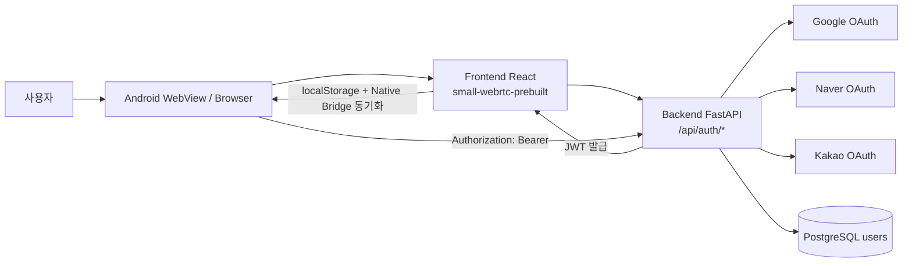
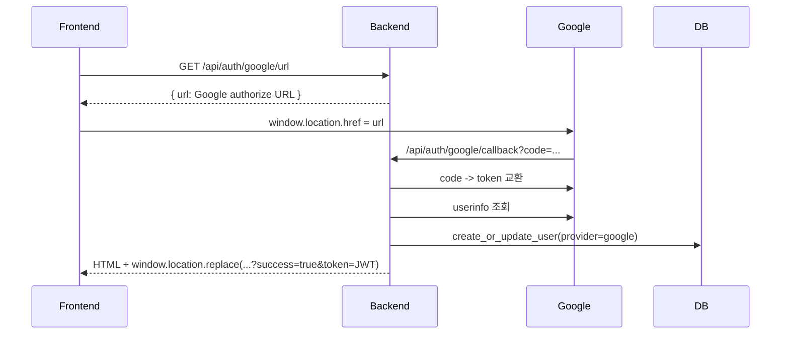
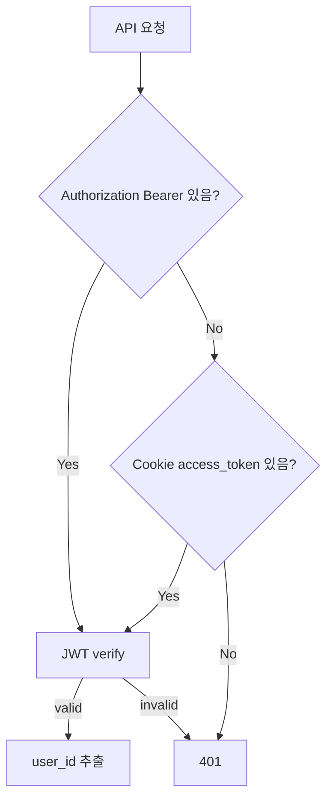
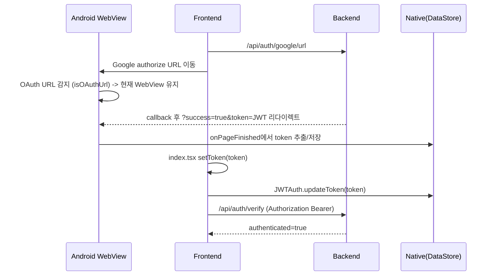
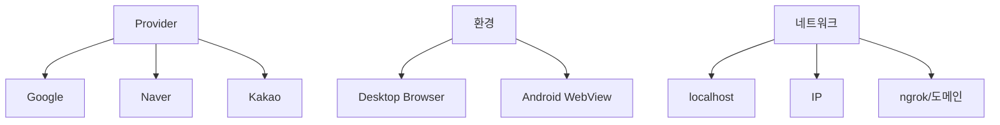

# OAuth 구현 상세 가이드 (Android / Frontend / Backend)

이 문서는 현재 코드 기준으로 OAuth 구현 상태를 **플랫폼별(Android, Frontend, Backend)로 분해**해서 설명하고, 특히 Android WebView에서의 fallback 처리 전략을 자세히 정리합니다.

---

## 1) 전체 구조 한눈에 보기



핵심 요약:

- Google은 현재 실제 로그인 플로우가 맞물려 동작
- Android WebView 특성(cookie/팝업/UA 문제)을 회피하기 위해 **URL token 전달 + JS/native 동기화** 구조를 채택
- Naver/Kakao는 backend callback 처리 로직은 구현되어 있으나, frontend와 일부 엔드포인트 계약이 아직 덜 맞춰진 상태

---

## 2) Backend (FastAPI) 구현 상세

주요 파일:

- `mobile/auth/routes.py`
- `mobile/auth/oauth.py`
- `mobile/auth/middleware.py`
- `mobile/auth/jwt_utils.py`
- `mobile/auth/db.py`
- `mobile/auth/app_setup.py`

### 2-1. OAuth 엔드포인트 구조

현재 라우트 기준:

- Google
  - `GET /api/auth/google/url` (frontend가 auth URL JSON으로 받아 이동)
  - `GET /api/auth/google/login` (fallback: 서버가 바로 리다이렉트)
  - `GET /api/auth/google/callback`
- Naver
  - `GET /api/auth/naver/login`
  - `GET /api/auth/naver/callback`
- Kakao
  - `GET /api/auth/kakao/login`
  - `GET /api/auth/kakao/callback`
- 공통
  - `GET /api/auth/verify`
  - `POST /api/auth/logout`

### 2-2. Google 플로우가 안정적으로 동작하는 이유



Google 콜백 설계 포인트:

- `routes.py`에서 `code` 중복 콜백을 `_used_codes` 캐시로 60초 dedup 처리
  - Android WebView에서 동일 callback이 2회 들어오는 케이스 대응
- 콜백 응답을 단순 307이 아니라 **HTML + JS redirect**로 반환
  - WebView에서 리다이렉트 신뢰성 확보 목적
- JWT를 cookie가 아닌 **URL query (`token`)로 전달**
  - Android WebView의 redirect 구간에서 httpOnly cookie 유실 가능성 대응

### 2-3. JWT 검증/인증 미들웨어

인증 우선순위:

1. `Authorization: Bearer <token>`
2. `access_token` cookie



의미:

- 브라우저 환경에서는 cookie 기반도 가능
- Android WebView에서는 bearer 기반으로도 동작하도록 열어두어 이중 안전장치 확보

### 2-4. DB 저장 모델

OAuth provider별 공통 upsert:

- key: `(provider, provider_user_id)` unique
- 저장: `email`, `name`, `profile_image_url`, `gportal_user_id` 등
- 로그인 성공 시 JWT `sub = users.id`

---

## 3) Frontend (React) 구현 상세

주요 파일:

- `small-webrtc-prebuilt/client/src/auth/store.ts`
- `small-webrtc-prebuilt/client/src/auth/LoginPage.tsx`
- `small-webrtc-prebuilt/client/src/index.tsx`

### 3-1. 상태관리 및 로그인 진입

`zustand` 스토어에서:

- `checkAuth()`: `/api/auth/verify` 호출
- `login(provider)`: 우선 `/api/auth/{provider}/url` 시도, 실패하면 `/api/auth/{provider}/login` fallback
- `setToken(token)`: localStorage 저장 + Native Bridge로 Android token 동기화

```mermaid
flowchart LR
  L[Login 버튼 클릭] --> U[/api/auth/{provider}/url 시도]
  U -->|ok| R[response.url로 이동]
  U -->|fail| F[/api/auth/{provider}/login으로 이동]
```

### 3-2. OAuth callback token 수신 처리

`index.tsx`에서 앱 시작 시:

1. URL query에서 `token`, `error`, `success` 파라미터 확인
2. `token`이 있으면 즉시 `setToken(token)`
3. URL에서 query 제거 (`history.replaceState`)
4. 이후 `checkAuth()` 호출

이 순서가 중요한 이유:

- `checkAuth()`보다 먼저 token 저장해야 첫 검증 요청에 bearer가 붙음
- URL에 token을 남기지 않아 히스토리/공유 노출 위험 축소

### 3-3. Android Native Bridge 연계

`store.ts`의 브릿지 계약:

- 서비스명: `JWTAuth`
- 액션: `getToken`, `updateToken`, `logout`
- 앱 최초 구동 시 localStorage token이 없으면 native에서 가져와 동기화

이 덕분에:

- WebView 프로세스 재생성/스토리지 상태 변화 시에도 native 저장 토큰으로 복원 가능

---

## 4) Android WebView 구현 상세 (핵심: fallback)

주요 파일:

- `mobile_pipecat_android/.../ui/CustomWebView.kt`
- `mobile_pipecat_android/.../activity/WebViewActivity.kt`
- `mobile_pipecat_android/.../activity/BaseWebViewActivity.kt`
- `mobile_pipecat_android/.../web/plugin/JWTAuthPlugin.kt`
- `mobile_pipecat_android/.../web/WebAppBridge.kt`

---

### 4-1. 문제 배경

Android WebView OAuth에서 흔한 이슈:

- Google이 WebView UA를 감지해 `disallowed_useragent` 403 반환
- OAuth 팝업/새창 흐름이 분기되며 콜백 유실
- redirect 체인에서 cookie 저장/전달 불안정
- intent 스킴과 fallback URL 처리가 섞이며 로그인 창 이탈

---

### 4-2. 현재 fallback 전략 (레이어별)

#### A) User-Agent fallback

`CustomWebView`에서 UA 문자열의 `; wv)` 마커 제거 후 `Mobile`만 유지:

- 목적: Google의 WebView 차단 heuristic 회피

#### B) OAuth URL 강제 in-place 처리

`isOAuthUrl()`로 Google/Naver/Kakao/`/api/auth/` 패턴 감지 후:

- 새 Activity(handoff)로 보내지 않고
- 현재 WebView에서 계속 진행

또한 `onCreateWindow`에서도 OAuth URL이면 팝업 생성 대신 현재 WebView 로드.

#### C) URL token 추출 fallback

`onPageFinished`에서 `?success=true&token=...`를 감지하면:

- native `DataStore`에 즉시 저장 (`saveNativeToken`)

즉, frontend localStorage만 의존하지 않고 native 저장소에 백업.

#### D) JS Bridge fallback (양방향)

Frontend <-> Android:

- `window.CodeEngineBridge.postMessage(...)`
- `window.callbackListener(...)`

`JWTAuthPlugin`가 `getToken/updateToken/logout` 처리:

- 프론트 localStorage와 native DataStore 토큰을 상호 동기화

#### E) Backend callback dedup fallback

WebView 중복 callback 문제를 backend에서 code dedup 캐시로 방어.

---

### 4-3. Android fallback 동작 시퀀스



---

## 5) 현재 구현 상태 정리

| 항목 | Google | Naver | Kakao |
|---|---|---|---|
| Backend authorize URL 생성 | 완료 (`/google/url`) | 부분(함수 있음, `/naver/url` 라우트 없음) | 부분(함수 있음, `/kakao/url` 라우트 없음) |
| Backend login/callback | 완료 | 완료 | 완료 |
| Frontend 버튼/스토어 | 완료 | 버튼 있음 | 버튼 있음 |
| Frontend와 라우트 계약 일치 | 완료 | 미완(`/url` 없음) | 미완(`/url` 없음) |
| Android OAuth URL 분기 처리 | 완료 | 도메인 식별 완료 | 도메인/intent 처리 완료 |

핵심 갭:

- 프론트 `login(provider)`가 `/api/auth/{provider}/url`을 먼저 호출하는데,
  현재 backend는 Google만 `/url` 제공.
- Naver/Kakao는 예외로 fallback(`/login`)로 내려가 동작 가능하지만, 첫 요청은 404/실패를 한번 겪는 구조.

---

## 6) 앞으로 Naver / Kakao OAuth 구현(정교화) 계획

아래 순서로 진행하면 Google과 동일한 안정성을 얻을 수 있습니다.

### 단계 1. Backend 라우트 계약 통일

추가 권장:

- `GET /api/auth/naver/url`
- `GET /api/auth/kakao/url`

동작은 Google의 `/url`과 동일하게 `{ "url": "..." }` 반환.

효과:

- frontend 공통 로직 그대로 사용
- provider별 불필요한 fallback 실패 제거

### 단계 2. state/PKCE 강화

Naver/Kakao 모두 CSRF 방어를 위해 `state`를 서버 세션(or 서명값)으로 저장/검증 권장.

```mermaid
flowchart LR
  A[login 요청] --> B[state 생성]
  B --> C[state 저장(서버)]
  C --> D[OAuth authorize URL에 state 포함]
  D --> E[callback 수신]
  E --> F{state 일치?}
  F -->|Yes| G[token 교환]
  F -->|No| H[차단 + 에러]
```

참고:

- 현재 Naver는 state를 생성해서 URL에 포함하지만, callback에서 서버 저장값과 대조하는 로직은 추가 구현 여지 있음
- Kakao도 state 도입 권장

### 단계 3. Android provider별 특수 처리 보강

Naver:

- 인앱 브라우저/외부 앱 분기 케이스 점검
- OAuth 도메인 whitelist 유지 (`nid.naver.com`)

Kakao:

- `intent://`, `kakaotalk://`, `browser_fallback_url` 처리 이미 존재
- 다만 OAuth 로그인 경로는 `isOAuthUrl`로 **항상 in-place 유지**가 중요

### 단계 4. 토큰 전달 방식 일관화 유지

Google에서 이미 검증된 방식 그대로:

- callback 최종 응답은 `?success=true&token=...`
- frontend 즉시 저장 + URL 정리
- native bridge로 영속 저장 동기화

### 단계 5. 테스트 매트릭스 구축



최소 검증 케이스:

- 로그인 성공 후 `/api/auth/verify` 200
- 앱 재실행 후 native token 복구 확인
- callback 중복 진입 시 1회 로그인으로 정상 처리
- provider 앱 미설치 상황에서 fallback URL/스토어 이동 정상 동작

---

## 7) Android WebView fallback 체크리스트 (운영 관점)

- [ ] UA에서 WebView 마커 제거 적용 여부 확인
- [ ] OAuth URL이 handoff/outbound로 빠지지 않는지 확인
- [ ] `onCreateWindow`에서 OAuth 팝업이 새 창으로 열리지 않는지 확인
- [ ] callback URL에서 token 추출/저장 로그 확인
- [ ] JS bridge `JWTAuth.getToken/updateToken/logout` 왕복 확인
- [ ] backend dedup cache로 중복 callback 안전 처리 확인

---

## 8) 결론

현재 구조는 **Android WebView의 취약 지점(cookie, popup, UA, intent 분기)**을 다층 fallback으로 방어하고 있으며, Google은 실질적으로 완성도 높은 상태입니다.  
다음 우선순위는 **Naver/Kakao의 `/url` 엔드포인트 추가 + state 검증 강화 + provider별 회귀 테스트 자동화**입니다. 이 3가지를 맞추면 세 provider 모두 동일한 안정성/운영성을 확보할 수 있습니다.

